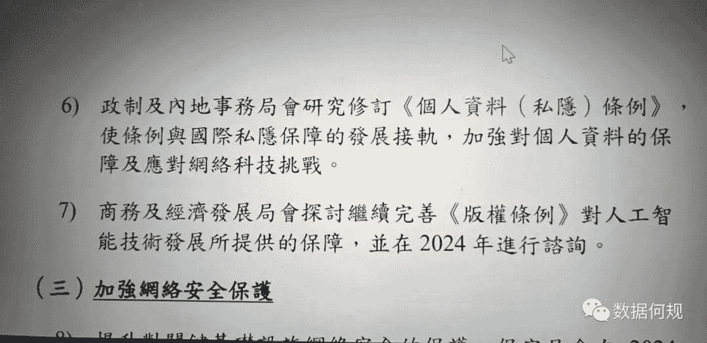
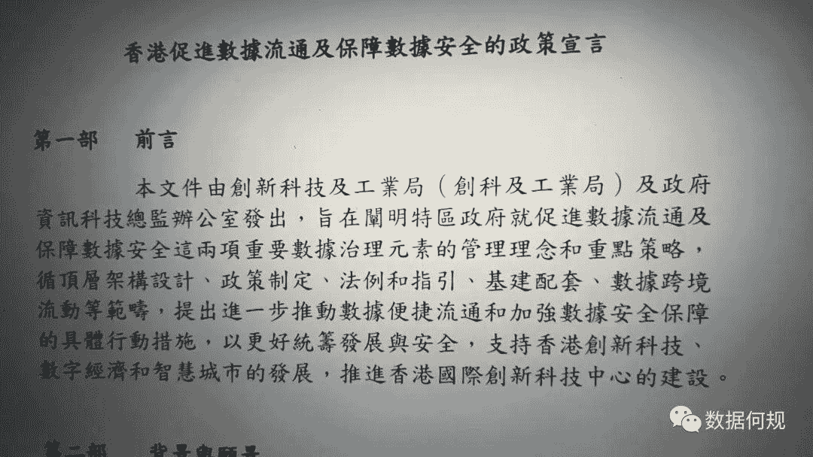
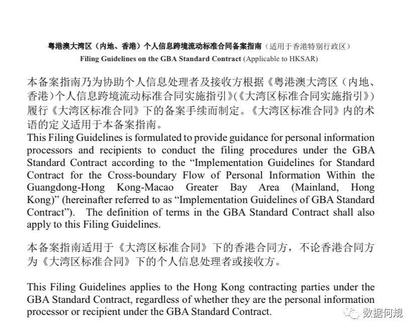
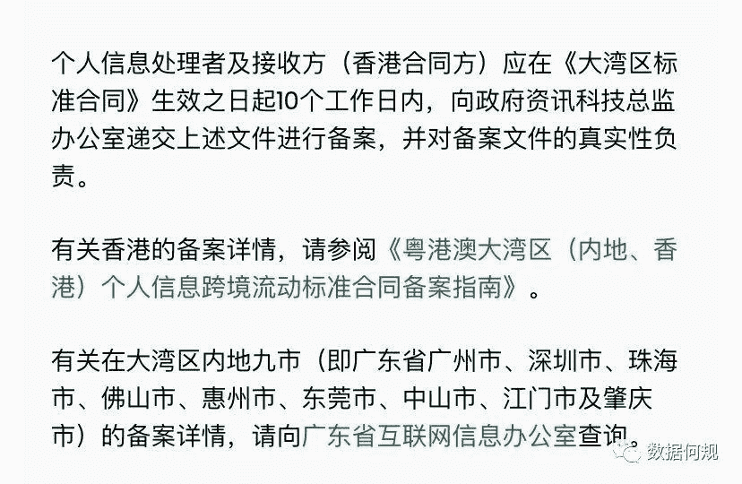

# 大湾区SCC讨论

> 来源：[https://docs.feishu.cn/docx/A1yJdIdyVowP6axejSbcigbznTh](https://docs.feishu.cn/docx/A1yJdIdyVowP6axejSbcigbznTh)

**-问：**粤港澳大湾区（内地、香港）个人信息跨境流动标准合同实施指引，这个啥意思？这个范本和普通的SCC啥区别？

**-答1：**备案材料里没有PIA报告，是不是只要企业备查，不用交cac审了？

**-答2**：适用范围超过安全评估吗？为啥我觉得，只要不包含重要数据的个人信息，都可以走这个湾区SCC吧。

**-答3**：我理解是可以，特殊点对点做了个单独通道。

**-答4：**粤港澳个人信息跨境两条路径：标准合同、个人信息跨境认证，大湾区认证后续会推出。

**-答5：****与此相关的，香港PDPO**现在PIA还不是强制性要求，明年PDPO可能要修法了。

可以结合前两天香港出的宣言一起看，换个角度理解。

**-答6：**只能在大湾区内部流动么，这区域。。也太小了点（小声。

**-答7：**香港私隐条例对于出境的第33节从来没有生效，也就是说香港数据出境本来是没有义务的，现在这个标准合同指引也适用到香港出境内地的个人信息，难道不是变相增加了香港出境方的义务吗？

**-答8：**只增加 香港 到 内地 的义务吧。之前那个认证规则我**也吐槽过，**从香港到大陆本来不要认证，现在反而要认证了。

**-答9：**看行业的，之前服务某个客户里就有出境报备一说，其中金融行业香港出境内地的就有报备批准，并非随意出境的。

**-答10：**香港金融机构数据境外存储需要保障香港监管机构无障碍**访问等要求，详见《致持**牌法团的通函 - 外间电子数据储存的使用。

**-答11：**那总部在上海，有子公司在广东深圳，是不是可以通过子公司进行备案，总部这边就不用走安全评估了？

**-答12：**是的，只是跨主体传输，没有合法性基础要单独同意？把业务链路捋顺就好。

**-答13：**我理解得你那得子公司作为个人信息处理者。如果总公司也是个人信息处理者，是不是得走内地流程了。

**-答14：**感觉脑子真的转不过来，既然  数据还是不能出大湾区，香港实体有作为  个人信息处理者  备案的情形吗？如果是作为接收方，那就应该是内地实体进行备案？

**-答15：****属地备案，不区分角色。我理**解是要双向备案，一旦签标准合同，双方都要各自去属地进行备案。香港方的备案指南是明确要求了。

**-答16：**pdpo 个人资料出境要求没生效，但因为这个备案要求，反倒要香港实体提交备案，还有白天大家提过过的pdpo dpia非强制，看看之后pdpo会不会修订吧…老感觉法理逻辑上不通…香**港原来也有**类似**标准合同概念(RMC****s)，pc****pd推荐在**港实体如有需向内地传输个人资料（即个人信息）通过签订**GB**A SCC来满足MRC要求及符合香港 《个人资料（私隐）条例》（PDPO) 资料保护原则。-答17：香港推荐RMCS，不强制。R就是recommended。-答18：企业是注册在广东九市，但服务器和数据中心在其他省份的OK吗？-答19：网信只核查注册地吧，其他的你不说，他也不问，合同也别写链路，PIA报告不用交，不用自寻烦恼。

总结：落地情况还要观察，增加香港侧的义务好费解。

[个人信息出境标准合同](https://cbe8t1r4a5.feishu.cn/wiki/wikcn38JfshR77gOMYja0I5rn8v)