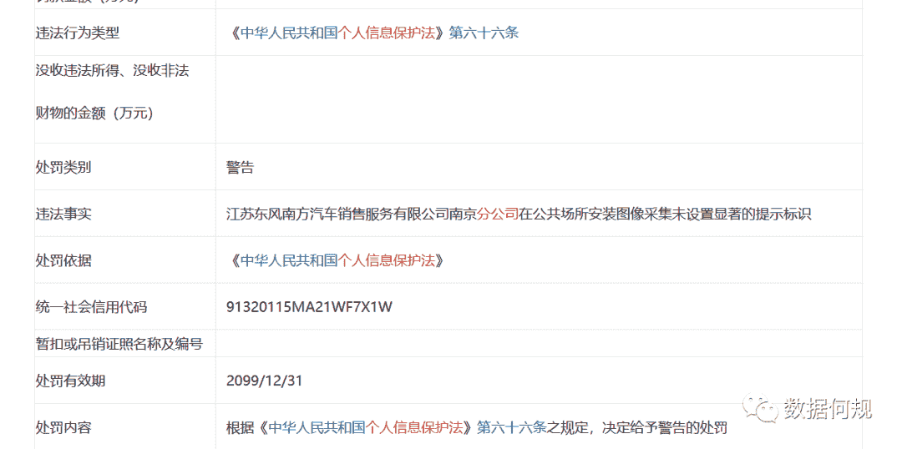
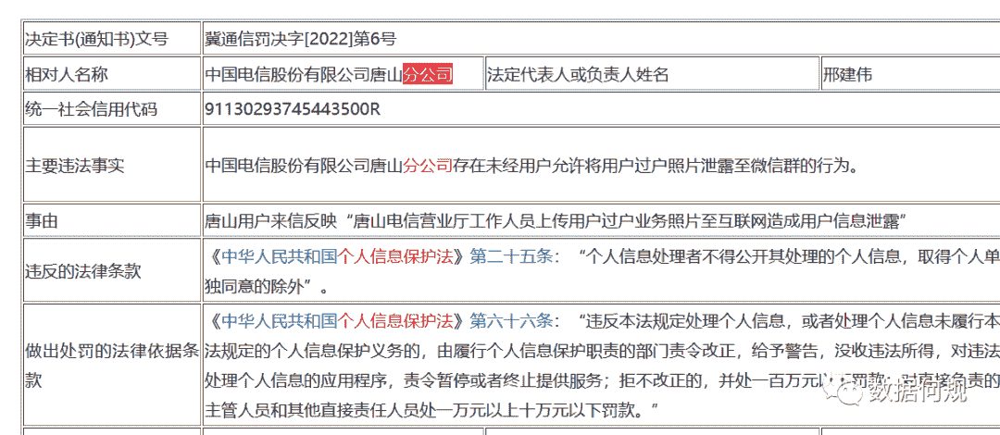

# 分公司可以签署大湾区SCC吗

> 来源：[https://docs.feishu.cn/docx/AFhVd57uuoGLAnxvVfpc1KhgnId](https://docs.feishu.cn/docx/AFhVd57uuoGLAnxvVfpc1KhgnId)

**-问：**总部不在大湾区，但有在大湾区的分公司，他们也独立开展一些跨境到香港的业务，这些分公司可以作为大湾区SCC的签约主体吗？

**-答1：**分公司**可以成为独立的个人信息处理者吗**？应该不可以吧...

**-答2：**分公司貌似不算独立法人实体

**-答3：****根据《个保法》只要分公司**只要满足独立决定个人信息处理目的的组织，也可以成为个人信息处理者吧。

**-答4：**很多区域营销活动是由分公司独立开展，客户也是分公司自己掌握的客户（总部可能并不掌握这些信息），如果这个时候还把总公司认为个人信息处理者感觉有些不妥（总公司没尽到信息安全管理责任？）。分公司作为信息控制者，民事责任由总公司承担，感觉更好点，也符合民法。

**-答5：**分公司可能有自己的独立业务，个保法也没说只有独立法人才可以是个人信息处理者，这是两个概念。关于分公司，民法典里好像也写了分公司有独立财产的，分公司有财产的，拿自己财产承担责任，不足的总公司担。

**-答6：**检索下了处罚，监管应该也是认**可分**公司作为个人信息处理者或者控制者的地位的，和民法典的思路是一样。

**-答7：**实操中说看是否**独立法人**。后续又告知内部研究后**外国银行分行**可以申报，如果是管理行，可以由这家管理行合并申报。但法理上确实是只看“是否独立决定处理方式和目的”来分辨处理者。

**-答8：**听**下**来大家的本意并不是想表达分公司不能成为独立的个人信息处理者 而是法人的分支机构是否属于个人信息处理者 可能在前面还需要一道审查？实践中可能并非所有的分支机构都能够独立决定个人信息处理的目的和方式 网信可能也有避免通过分支机构的数量拆分以规避安全评估门槛的考量。此外也与行业相关 分公司在某些行业 例如金融行业 独立处理个人信息的情形 可能是比较常见的。

**-答9：**同意，**金融、广告公司、经纪公司很常见**。

**-答10：**我们也咨询了一下，金融机构分公司不是法人，营业执照写的也是负责人，他需要请示一下。并且，由于广东范围内的实施细则没有出，所以现在大湾区版本的标准合同，也是没有备案渠道的。

**-答11：****同问过分公司、代表处这**些怎么办的问题，老师说理论上他们要单独看待，但是承诺书等材料是法代签名，如果只有“负责人”之类的没有法代，他们当时也说要研究下(不过再也没给过答复)

**-答12：**我们也私下和相关老师交流过，初步认可讨论的观点，根据业务模式，可以认定为个人信息处理者。

**

总结：期待灵活的政策**。

[个人信息出境标准合同](https://cbe8t1r4a5.feishu.cn/wiki/wikcn38JfshR77gOMYja0I5rn8v)