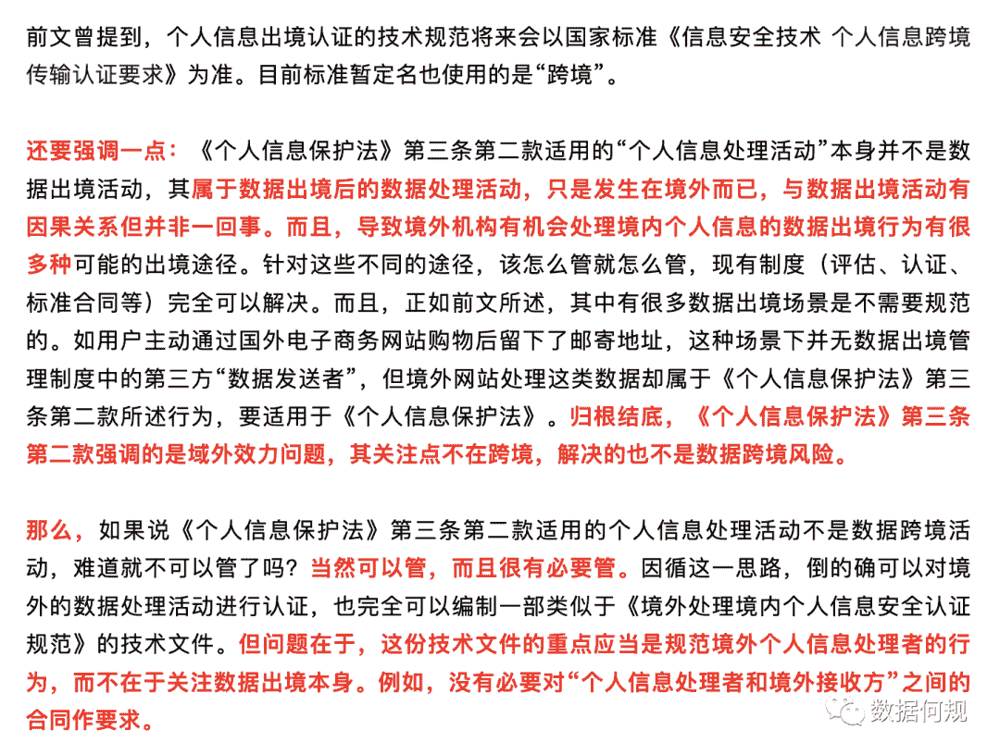
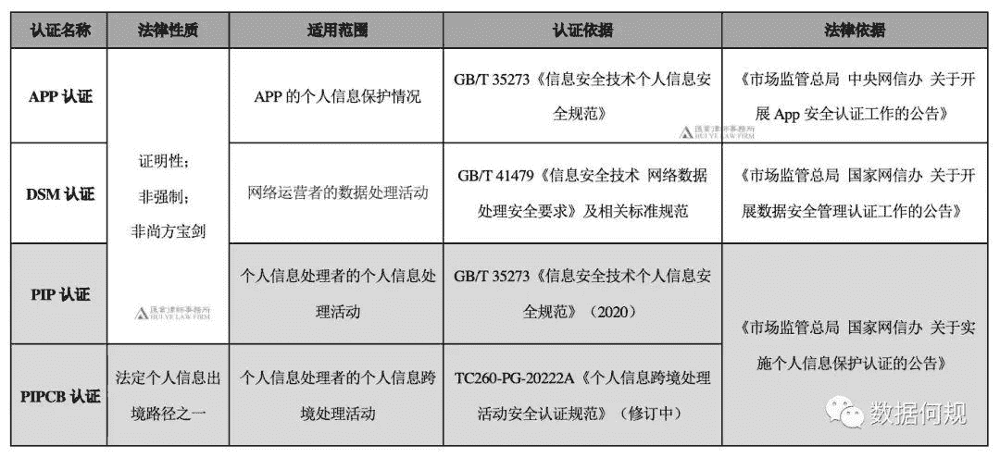

# 出境认证

> 来源：[https://docs.feishu.cn/docx/ZNhodD6ZuoNidXxpfGQc74sHngc](https://docs.feishu.cn/docx/ZNhodD6ZuoNidXxpfGQc74sHngc)

**-问：**《[关于实施个人信息保护认证的公告](https://mp.weixin.qq.com/s?__biz=MzAwMjU0MjIyNw==&mid=2651430716&idx=1&sn=c418d99d2acaed7125e4cc924bf936df&scene=21#wechat_redirect)》一声不吭就发了，大家怎么看？

**-答1：**看这个文本的意思，35273还是要更新的。另外，这个认证要找哪个机构似乎还没有确定，暂不具备可执行性。

**-答2：**机构的话 就是CNCA吧。CNCA是统管所有认证机构的。但是发不发cnas标 就看情况了。

**-答3**：鼓励认证，挺妙的。

**-答4：**有了认证就可以出境了。

**-答5：**左老师这篇信息量太大了《又来了一个认证，数据出境政策是否已然水落石出？》

**-答6：**从这一段理解，境外直采还是要走出境前置评估/认证/标准合同手续的。

**-答7：**是的，各地网信办咨询结果亦是如此。如果要做评估，由国内代理机构做申报。

**-答8：**文内 个人信息保护认证 好像趋向于27701，ISO27001 国内叫 GB/T22080。

**-答9：**汇业黄春林律师团队对几个证进行梳理，供大家参考：

**-答10：**针对跨境认证的梳理，海问杨律师团队的梳理可以看看：《跨境认证——解读个人信息出境的第三条路》

[个人信息保护认证](https://cbe8t1r4a5.feishu.cn/wiki/YZoyw0sjxiF7HykXSZ0cWpSTnfd)