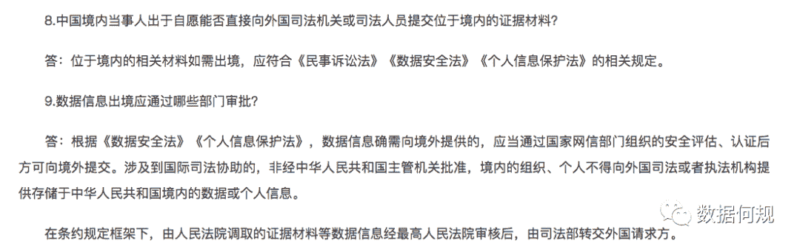

#  涉诉数据出境

> 来源：[https://docs.feishu.cn/docx/YiXfdb2wZoxG6Rxwt89c9DJWnmf](https://docs.feishu.cn/docx/YiXfdb2wZoxG6Rxwt89c9DJWnmf)

**-问**：想请教大家现在涉外诉讼或仲裁针对主动提交的证据，如何处理数安法的36条和个保法第41条的呢？

**-答1：**看看司法部的官方问答：http://www.moj.gov.cn/pub/sfbgw/jgsz/jgszzsdw/zsdwsfxzjlzx/sfxzjlzxxwdt/202206/t20220624_458335.html

更为关键的是最底端的**咨询电话**（如果能打通的话。

**-答2：**是不是可以解读为只要中国籍自然人不在境内（比如在HK什么的，就可以不按这个规定来向国外司法机关提供证据了。

**-答3：**但如果是提供的境内数据也不行吧。

**-答4：**确实，直接调取境内资料应该不行，境内自然人把资料带到境外再提交境外地方机构——可能还是要看证据类型，这个场景合不合规还是蛮模糊的

**-答5：**理论上你带个u盘出境也是出境了，但不用评估。（如果u盘 里面有重要数据咋办

**-答6：**电脑、手机里的资料也很多。

[数据出境法规理解](https://cbe8t1r4a5.feishu.cn/wiki/wikcnukpwDIgw3POvs1eJLEgY2d)