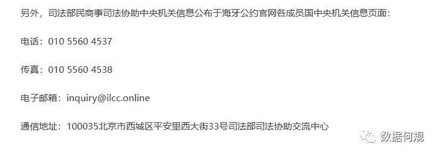

# 诉讼数据出境

> 来源：[https://docs.feishu.cn/docx/AZsbdHzx5oCI9Yx2vG2cOrNendc](https://docs.feishu.cn/docx/AZsbdHzx5oCI9Yx2vG2cOrNendc)

**-问：**请问下大家，近期有通过司法部程序向香港仲裁机构提供证据材料/数据的吗？听说前段时间司法协助中心暂停受理了，不知目前是否恢复或有其他程序通道。

**-答1：**最近咨询司法协助中心，都回复找网信办，但网信办都说不涉及个人信息和重要数据的不归他们管，现在有什么程序通道可行的么？

**-答2：**不是任何数据都要安全评估，部分涉及个人信息的也被豁免了。

**-答3：**昨天问CAC还让去联系司法协助中心，说CAC会尊重主管部门的意见，我也明确说涉及个人信息出境了。

**-答4：**这个电话我没打通过，反而邮件联系会回复的。

[出境业务场景讨论](https://cbe8t1r4a5.feishu.cn/wiki/UYqIw4vwQicJvEk4sLgcNBXunae)