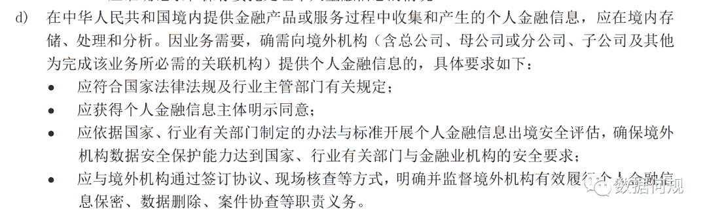

# 特殊行业数据本地化存储要求

> 来源：[https://docs.feishu.cn/docx/Woowdd9wGoynhYxYlvxcgETAngc](https://docs.feishu.cn/docx/Woowdd9wGoynhYxYlvxcgETAngc)

**-问：**目前一些情形下（比如CIIO），原则要求本地化存储，确因业务需要的，走安全评估或相关的路径；那是否有特定行业、特定数据还会更严格，无例外，即必须只能本地化存储的？好像没有？

**-答1：**人民银行《个人金融信息保护技术规范》

**-答2：**《法人金融机构洗钱和恐怖融资风险管理指引（试行）》第41条：……有关国内司法冻结、司法查询、可疑交易报告、行政机构反洗钱调查等信息不得对外提供。

金融行业比较明确必须本地化的数据，是反洗钱工作信息。

除此之外的信息，原则上和实践中存在大量出境的情况，主要有两个原因，一是金融行业比较特别在于有灾备的要求（在人行数据新规中提到数据可用性也是同理），还有一个历史原因，是外资机构入华时，有一些优惠政策，金融监管部门对系统部署方案做了批复，比较常见的香港金融机构进入内地时，受惠于CEPA, 内地的子公司可以使用香港的系统，也不违反金融监管的要求。有趣的地方就是以前的金融监管规定，与现在的数据合规规定怎么衔接，是目前最头疼的问题。

**-答3：**之前梳理过一个清单，还是有一些的，仅举几个例子：

**总结：凡有特殊规定，必有例外。**

[本地化存储](https://cbe8t1r4a5.feishu.cn/wiki/ZWwuw6K4AiYEBVkYZ6AcqZt8nZW)

[金融](https://cbe8t1r4a5.feishu.cn/wiki/wikcnHIfJ52k5IkLpp0iNuSUU1c)

[测绘](https://cbe8t1r4a5.feishu.cn/wiki/wikcnwa5ggqNFKo06JcGcWvzosf)