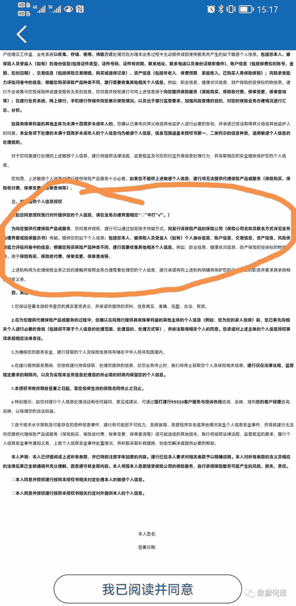
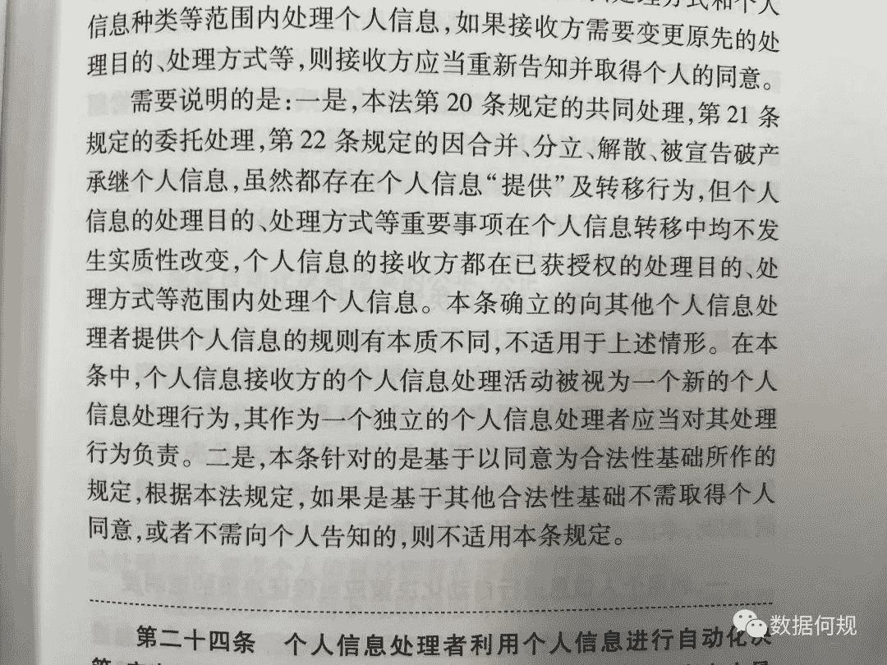

# 单独同意的实现

> 来源：[https://docs.feishu.cn/docx/LAyNduW5Uo9MsFxZoiMcvFLmnee](https://docs.feishu.cn/docx/LAyNduW5Uo9MsFxZoiMcvFLmnee)

**-问**：一些平台机构，如电商平台，保险中介平台，把用户信息给商家或保险公司办理业务，属于履行合同所必须，无需征得用户单独同意的场景吗？我看建行履行了单独告知，部分机构把其定义为履行合同所必须。

**-答1：**电商买东西，商家要把信息给到快递公司这种，我理解算的。而且很多app的逻辑其实不是给到第三方，而且有一个让你自己填写的界面，然后可以从地址簿调去地址联系方式，从而便捷填写。逻辑还是稍有不同。具体情况具体分析吧。

**-答2：**保险中介公司属于银保监会管辖，有监管的。有对应法律法规要求的。保险中介公司也是要有保险代销牌照的。这点和电商平台收集用户地址信息，完全不一样。我指的不一样，是指收集，存储，使用，销毁等方式、方法、时效性等。另外，即便是履行法律义务。个保法也明确了，数据给第三方就是要单独告知的。保险和电商还有差异的点就是。保险因为是持牌，所以保险中介和保险公司都可以拥有用户信息的。

**-追问：**这样要试试才知道了。履行合同所必须数据给第三方也需要单独告知呀，我看建行单独告知了，支付宝的这种就放在统一的隐私授权了，所以有些疑惑。

**-答3：**操作层面上来看。有明显进入第三方页面流程，且共享了信息给到第三方，未单独授权，CCRC和隐私保护检测机构都会提质疑的。但是纯接口传的，没页面这种。只能呵呵呵了。我举个例子，把用户信息传给广告联盟。这种一般性都是接口传的。隐私政策和向第三方共享信息清单里面会写。但是单独授权这种，从技术和用户体验上讲，你也不好做。

**-答4：**保险中介 就是保险代销  有代为保险公司收集和合规收集的义务，在签署合约阶段可以通过 明示告知 完成自身义务，通过在签署协议阶段加入保险公司的隐私政策 通过勾选方式 完成保险公司的明示同意义务。交互合规上 在跳转第三方页面前  需要有 明示并得到用户同意的步骤 看164号文。是否增加单独授权 看业务模式。如果 进入第三方的例如sdk  沙箱环境 完成 交易  在这步之前需要进行单独授权。接口传输行为  在 政策中 进行披露。

**-答3：**单就这个事项来说，被处理的信息里含有健康信息，那就是涉及敏感个人信息的处理。记得之前群里讨论过，在属于履行合同所必须的前提下，如果处理的信息是敏感信息是否还需要单独同意，印象中并无确切官方结论。在此情况下，不同的处理者秉持的风控尺度不一样吧。

**-答4：**涉及提供，就不能用履行合同必要的合法性基础，应当单独同意。单独同意最好要用独立的文本，否则难以满足个保法要求。

**-答5：**单独同意是同意的子集。履行合同所必需和单独同意无关。依据是法工委杨合庆老师写得个保法释义。

**-答6：**我理解，法条没有要求单独告知，只是一般在单独同意的界面同时把增强告知落实了。在豁免单独同意的情况下，隐私政策等文本覆盖了法条要求的告知事项就是合规的。只是难点在于，论证履行合同所必需的必要性比较模糊，为了稳妥起见，都做了单独同意。相应的问题之前也讨论过，走了同意就可以撤回同意。举个例子：开户的人脸识别，都是开户实名制认证的要求，也是有明确的监管规定的（效力层级待讨论），理论上属于金融机构履行法定义务。但是大部分机构还是做了单独同意的界面。比较困惑的点是，监管规定一般会说，需要核验身份。也没说一定要人脸识别。这种算不算法定义务。

**-答7：**主动提供敏感信息也算单独同意吧，35273主动填写是在明示同意下。这种情况下的告知在填写款里做可以吗？

**-答8：**是的，是一种“即时告知”方式，而且场景限定明确不易误解。但只是文字内容有限，难以用于一些比较复杂的单独同意场景下的“增强告知”。

[单独同意](https://cbe8t1r4a5.feishu.cn/wiki/wikcnJE9n6JylcRx7c3La4Yjahd)

[告知](https://cbe8t1r4a5.feishu.cn/wiki/MBURwAcGAikdAmkoOqJcwnmKnPh)