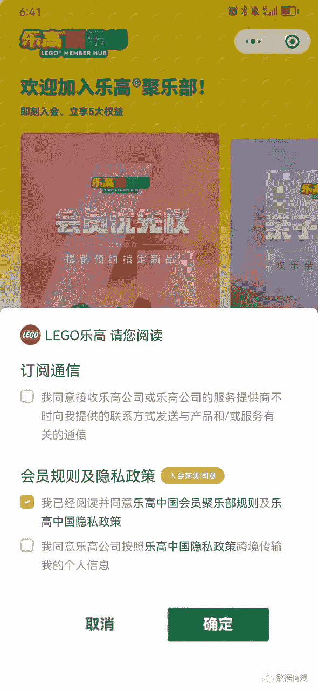
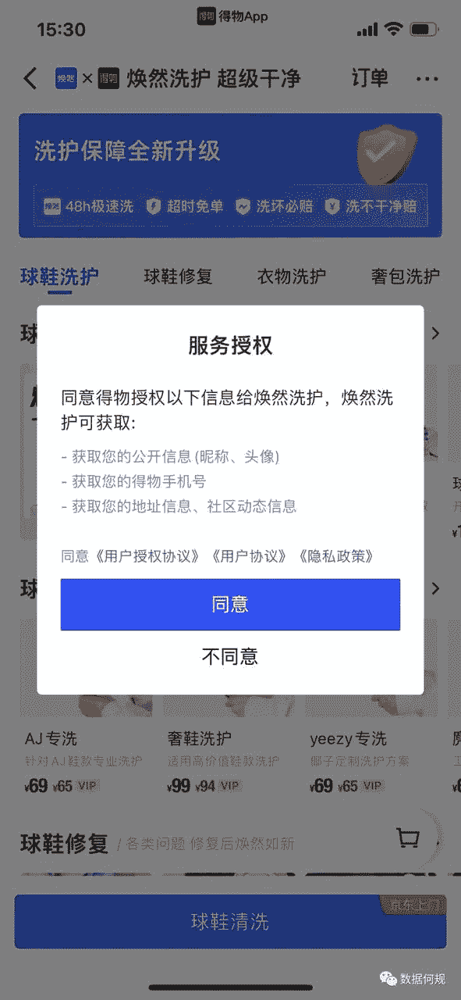

# 单独同意案例

> 来源：[https://docs.feishu.cn/docx/GGlzdYuCGo410oxvsF7csfhfnpb](https://docs.feishu.cn/docx/GGlzdYuCGo410oxvsF7csfhfnpb)

**-问：**想问问大家有没有遇到网信办要求证明客户联系人出境的单独同意的情况，实践中大家都会怎么处理呢？简单来讲单独签署同意书会好证明一点，但是如果大部分客户都不配合呢？

**-答1：**最近各个项目都收到了这个反馈，应该是国家CAC**的标准手势。我们看下来处理方式多种多样：线下签署，线上单独勾选、弹窗、签署都**可以；toC的服务直接触达用户签署，toB的服务直接触达法人签署；也有试过成员机构签署一致的准入规则，表达做出单独同意的。目前的难点是CAC所理解的单独同意形式比较局限。

**-追问：**单独同意有什么比较好的案例吗？

**-答2：**乐高，**个人信息跨境**。

**-答3：**得物，**对外提供**。

[单独同意](https://cbe8t1r4a5.feishu.cn/wiki/wikcnJE9n6JylcRx7c3La4Yjahd)