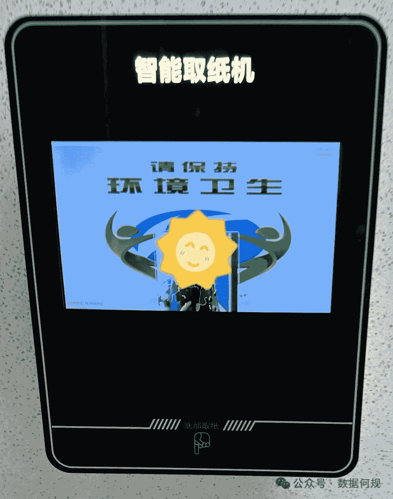
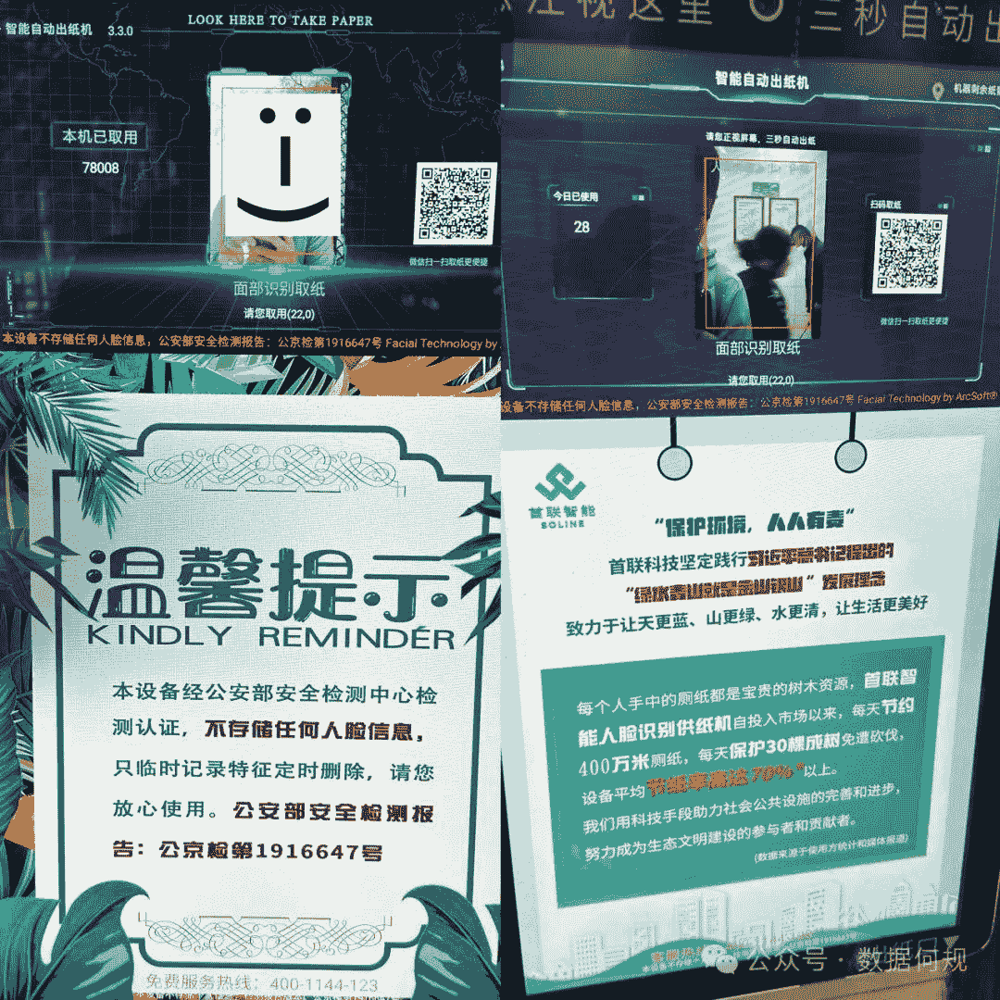
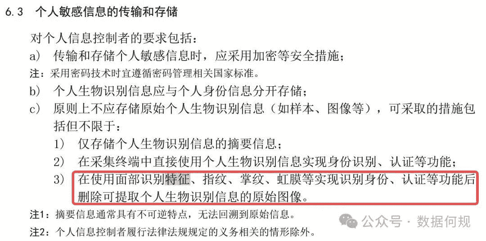
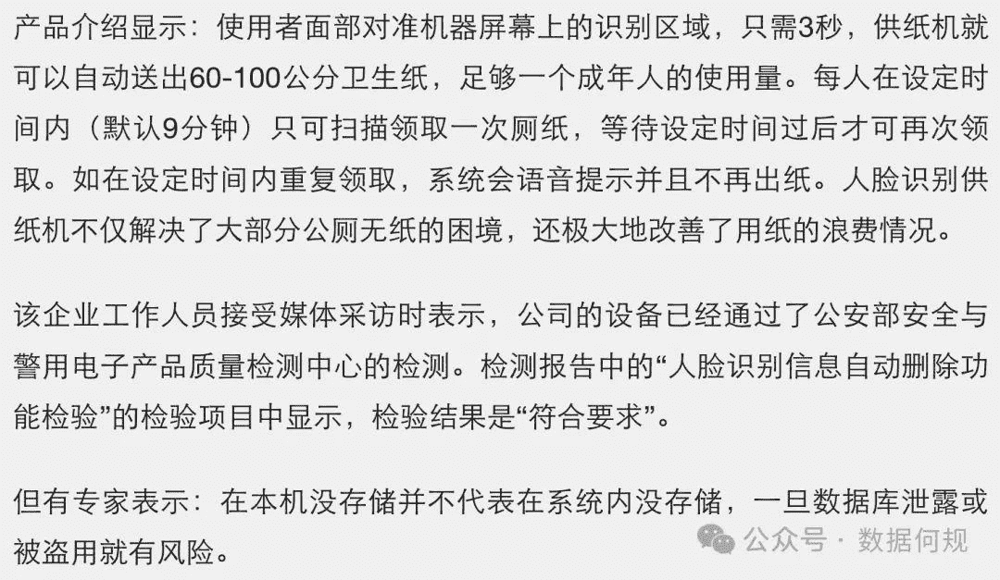
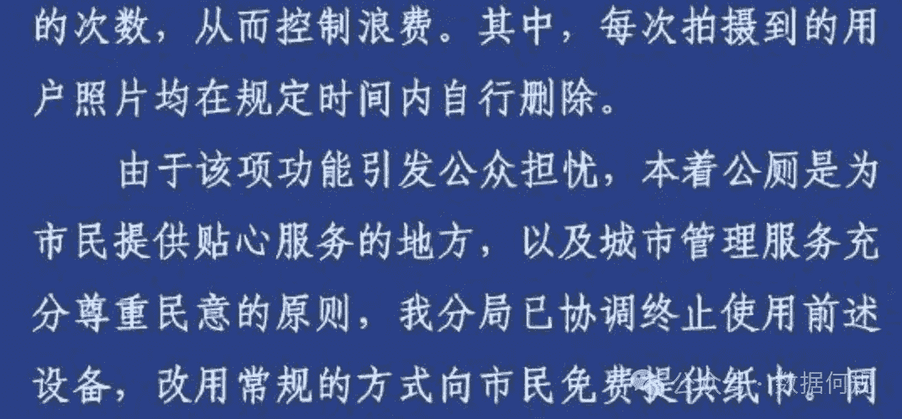

# 人脸识别取纸的告知同意

> 来源：[https://docs.feishu.cn/docx/BziHdPcC5ouVOPxXDoXcuI3Gn93](https://docs.feishu.cn/docx/BziHdPcC5ouVOPxXDoXcuI3Gn93)

**-问：**感觉这个还挺不合规的，收集人脸信息，30分钟内不得再取。不过好在没有上云，只是在本地，因为另一台机器还能取。

**-答1：**没做**告知**，没做**单独同意**，也大概率没做PIA，还缺乏**必要性**[，很不合规，但确实也](https://mp.weixin.qq.com/s?__biz=MzU1MzAzNzcwNw==&mid=2247490680&idx=1&sn=384fb1ba13cc842a583f41cd821d3aa1&scene=21#wechat_redirect)有需求，详见：旅途人脸识别使用观察。

**-追问：**碰到个做了一点告知的，但不存人脸信息，怎么能防止我二次拿纸呢？

**-答2：**只说明定时删除，颗粒度够吗，多久删也没说清楚啊。

**-答3：**右边那边勉强算说明了一下必要性？节约用纸。。

**-答4：****不是**缓存（缓存一般存储在内存中），而是存储在机器的存储卡中。不是存的人脸原图，存的是人脸信息特征值。刚扫脸取过纸，提取并记录了你的人脸特征值，过几分钟你又来扫脸取纸，就再提取一次特征值跟已存储的一堆特征值进行比对，如果有匹配的，机器就会认为你已经扫脸取过纸，这次就不给纸了或这次得加钱了(反薅羊毛)。

即便如此，该设备中没来得及及时删除的一堆人脸特征值仍有非法获取、滥用等风险。人脸特征值不等同于哈希值（摘要信息），仍存在关联（定位）到自然人的可能，仍属于个人信息。虽然刷脸验证取纸很方便，但为了这种方便而采用人脸验证这种较高风险的措施，不符合洋人说的“比例原则”。

**-答5：**不需要特征值，取一段就行，就像一般餐厅只校对你手机号后四位

**-答6：**如厕取纸这样的便利措施，再怎么要紧再怎么利益重大，也不会比人脸生物特征()要紧吧？

**-答7：**最好的方案是不要用人脸识别，就取两张纸上个厕所，动不动就用人脸信息，虽然是特征值 但显然是弊大于利。类似的机器之前东莞上线过，被要求下线了：网友炸锅！东莞星级公厕“刷脸取厕纸”引热议！最新回应来了！

**-答8：**我网上搜不同人的正面肖像，展示给它，是不是可以一直取？

**-答9：**看了这个我觉得悲哀的是另一个问题，这个设置的初衷是先假设民众会浪费厕纸，然后设计了这个限制浪费的扫脸装置……什么叫这个出纸量足够成年人正常用量？如果谁拉肚子了，就不能拿纸了？

**-答10：**要看他采用的具体技术了，**最基础的是静态的2D面部识别，再高级一点****的是**3D面部识别，再高级一点的是活体检测()。如果只要**是个人脸就**能通过（2D），那就可以这么做。如果是3D或者活体检测，那光给一张静态照片可能就不行了。小学生用照片破解丰巢刷脸？ 3D面部识别的背后。不过话说回来，就为了取一张厕纸，采用3D人脸识别甚至活体检测，这也太夸张了，要平衡一下成本和风险。

总结：不合规，但有一定的合理性，数据合规落地不容易呀。

[告知](https://cbe8t1r4a5.feishu.cn/wiki/MBURwAcGAikdAmkoOqJcwnmKnPh)[单独同意](https://cbe8t1r4a5.feishu.cn/wiki/wikcnJE9n6JylcRx7c3La4Yjahd)[合法性基础](https://cbe8t1r4a5.feishu.cn/wiki/wikcnMO3dv4wwxpr7KunwIHHfwd)