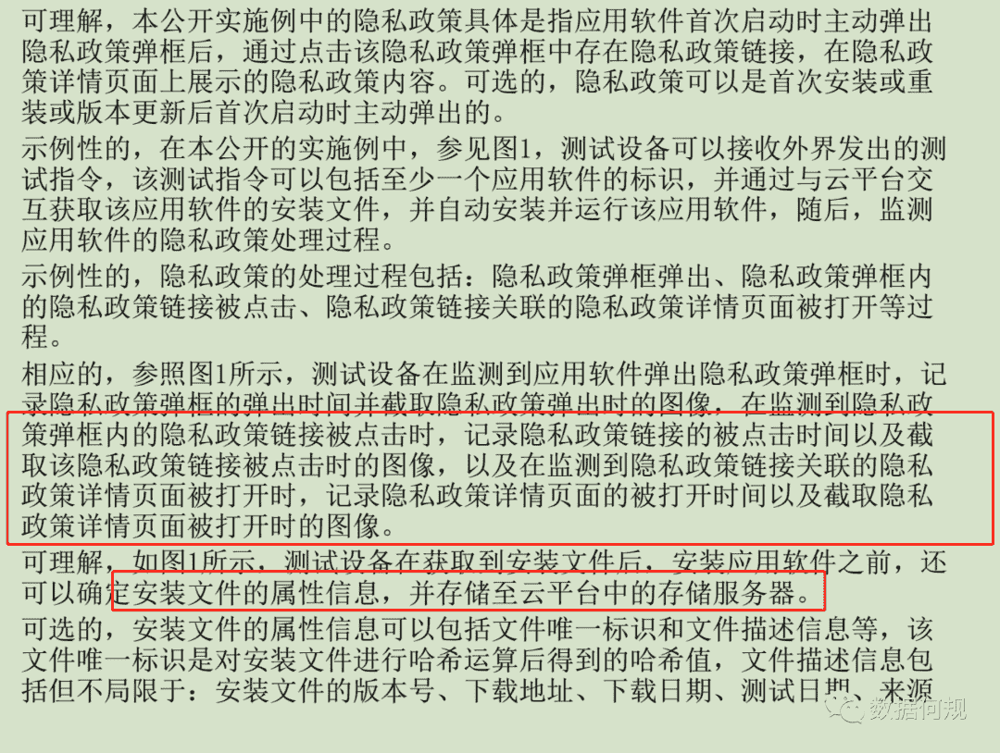
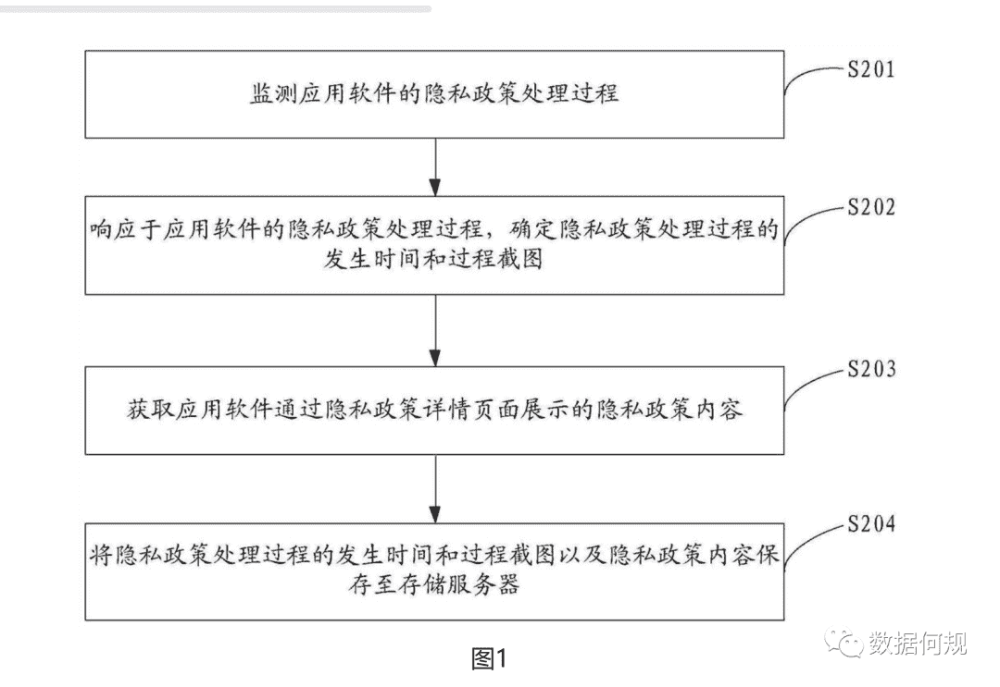

# 如何证明用户同意隐私政策

> 来源：[https://docs.feishu.cn/docx/AlMXdtAhqozhyexg4ChcutIsnjd](https://docs.feishu.cn/docx/AlMXdtAhqozhyexg4ChcutIsnjd)

**-问：**目前企业如何对app隐私政策进行“告知+同意”留证吗？即如何证明用户已经点击同意了隐私政策。后台需要留存什么数据，比如用户手机号、点击时间、app版本号等数据吗？

**-答1：**埋点咯，具体留存什么还是看需要。一般来说用户id+点击同意的动作埋点就可以满足。基于安全风控的考虑，可能有其他id。

**-答2：**隐私政策版本，当然应用名版本啥的也要啦。

**-答3：**一般还需要用户的访问设备号、IP。

**-答4：**一般后台日志和前台交互版本说明截图都需要。比较重要的更新授权，也可以做个公证认证。

**-答5：**感觉系统留操作日志之类应该是可以实现吧。最近公司刚做了日志保存之类的整改，把一些监管要求的日志长期保存。

**-答6：**一般是后台日志，加版本更新的隐私政策及用户点注册过程的公证，之前咨询过有一些公证机构，也有可以接入api接口实时公证的，不过这种成本貌似比较高。不过以前看过一些案例，法院好像有的也并没有一定要求有公证，看过还有现场注册登录公证的。

**-答7：**埋点方式可以满足电子签名法要求，就行了，我的理解。

**-答8：**公证处有一种证据公证，把流程每个步骤都固化下来，流程中的用户操作体现告知和确认。但是一般这种是提前做了应对司法程序的，不是应对监管的。

**-答9：**电子签名都是有的，包括身份验证，ca证书啥的。如果没记错，应该是客户去搞了cfca。后面法院就不认啦。

**-答10：**我接触的也是规则/协议系统落区块链存证，交互层面依靠埋点➕日志（埋点也要靠产研调性），因为交互往往频繁变动，也上链存证不太经济实惠，必要性（性价比）变低了。

**-答11：**这个问题蛮有意思，百度还申请了相关专利。

**-答12：**截图让用户知晓了吗？后台截图吗？终端设备提权了？YDT2407-2021有一条，后台截屏录屏，应在用户确认的情况下才能启动。

[合法性基础](https://cbe8t1r4a5.feishu.cn/wiki/wikcnMO3dv4wwxpr7KunwIHHfwd)