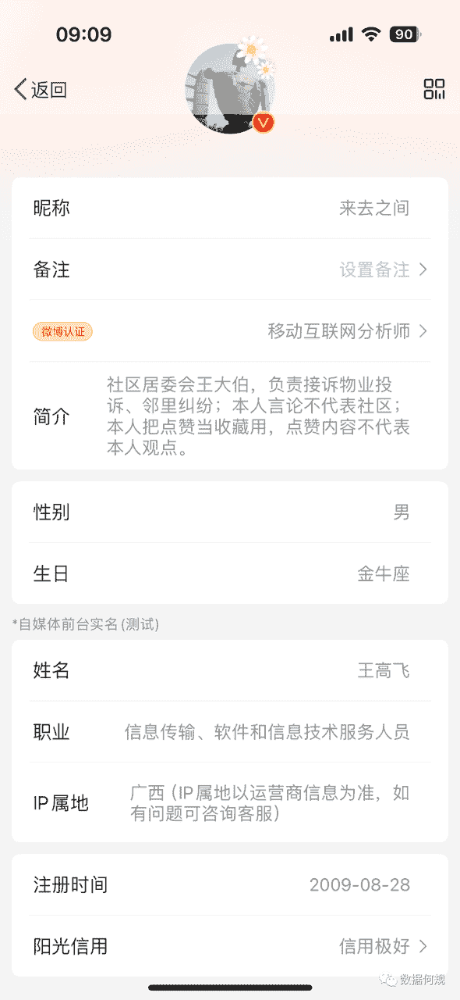

# 前台实名的合法性基础

> 来源：[https://docs.feishu.cn/docx/EsC9dqODVoUVcPxd1w8cOibcn7e](https://docs.feishu.cn/docx/EsC9dqODVoUVcPxd1w8cOibcn7e)

**-问：**平台将引导部分头部自媒体账号展示实名信息。关于“前台实名展示”，🛰️、快手、抖音、🧣发公告了！所以这个的合法性基础到底是啥？

**-答1：**基于同意。

> 🧣站**方将**于近期引导头部“自媒体”账号进行前台实名展示，以此进一步规范“自媒体”账号运营管理，站方将于近期引导社会时事、军事、财经、法律、医疗等专业领域100万粉丝以上的“自媒体”账号填写实名信息，后续将逐步扩大到相关领域50万粉丝以上的“自媒体”账号，经用户同意后进行前台实名展示。

> 🧣

> 根据公告，前台实名账号范围为：涉国内外新闻、社会热点和医疗、司法等专业领域，粉丝量在5**0万以上**的“自媒体”账号，将分批次、分阶段收到相关通知，可根据通知提示进行操作，征询同意后在个人账号资料页展示实名信息。

> 快手

> 根据🛰️👸号、视频号“粉丝”情况，平台100**万“**粉丝”以上的“自媒体”账号在用户确认同意展示后，账号注册主体为个人类型的将显示注册人真实姓名，机构类账号显示企业、机构名称，相关实名信息可在账号资料页进行查看。

> 🛰️

**-答2：****这个同意其实很tricky，不**同意的话，会限流。同意的有效性也很难经得起推敲。

> 平台鼓励“自媒体”创作者真实表达，为用户提供更优质、可信赖的内容，未对外展示实名信息的100万“粉丝”以上“自媒体”账号，账号流量、收益等将受到限制。

> 🛰️

**-追问：**不知道会具体怎么展示。

**-答3：**可以看看🧣CEO的“来去之间”，他已经公示了。目前看是只有姓名（名称）。

**-答4：**前台实名制依据，有可能是这个《[互联网用户账号信息管理规定](https://mp.weixin.qq.com/s?__biz=MzAwMjU0MjIyNw==&mid=2651413000&idx=2&sn=2f53b1b1859efd16fb44f5356fc77497&scene=21#wechat_redirect)的第11条和13条，以及之前7月份的一份文件《关于加强“自媒体”管理的通知》。

> 第十一条 对于互联网用户申请注册提供互联网新闻信息服务、网络出版服务等依法需要取得行政许可的互联网信息服务的账号，或者申请注册从事经济、教育、医疗卫生、司法等领域信息内容生产的账号，互联网信息服务提供者应当要求其提供服务资质、职业资格、专业背景等相关材料，予以核验并在账号信息中加注专门标识。

> 《互联网用户账号信息管理规定》

> 第十三条 互联网信息服务提供者应当在互联网用户公众账号信息页面，展示公众账号的运营主体、注册运营地址、内容生产类别、统一社会信用代码、有效联系方式、互联网协议（IP）地址归属地等信息。

> 《互联网用户账号信息管理规定》

[合法性基础](https://cbe8t1r4a5.feishu.cn/wiki/wikcnMO3dv4wwxpr7KunwIHHfwd)

[公开](https://cbe8t1r4a5.feishu.cn/wiki/DYLZww9rMit1Plkg1rtcv351nOb)