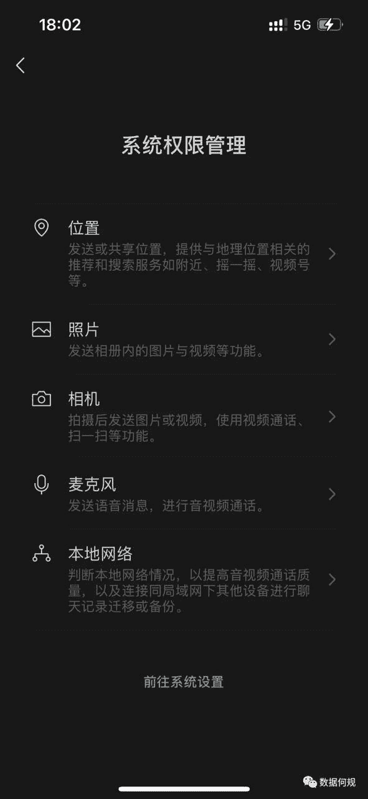

# 同意的统计维度

> 来源：[https://docs.feishu.cn/docx/AZlDd7ilHoT1XExLMhOcFIron5g](https://docs.feishu.cn/docx/AZlDd7ilHoT1XExLMhOcFIron5g)

**-问：**广东高院发布个人信息保护典型案例中腾讯这个案子，关于不符合正当性原则要求这点（抛开必要原则的问题），用户在注册登录时勾选同意过🛰️好友关系的授权，用户卸载后（非注销），可以认定为撤回同意么？这里是不是指卸载后表示撤回同意，二次安装继续使用🛰️好友关系需要重新取得同意。

> 微视APP在原告二次下载微视APP未予授权的情况下继续使用其🛰️好友关系的行为并未获得有效的用户知情同意，不符合正当性原则。

> 👸号：深圳市中级人民法院微视获取🛰️好友信息被诉！法院这样判……

**-答1：****卸载不算行使撤回权**吧，卸载后app 还是会保留在资源库中诶。

**-答2：**如果这也算撤回授权，那刷机也算了。

**-答3：**登录解除授权关系 应该在🛰️侧完成。好友授权关系 在自身app 处完成。🛰️的昵称头像 用的是一个 api scope。

**-答4：**那这里认定二次下载时未获得有效的用户知情同意的点是？因为重新安装后，仍然提供了🛰️好友关系授权的勾选栏，但是用户没勾选么。视为对🛰️好友关系的授权作出变更的决策？那我是不是重新安装后不提供这个勾选栏更保险。

**-追问：**顺便问一个问题：户切换账号登录之后，对个人信息收集做出的同意（包括给隐私政策点同意、给敏感权限收集点同意）是不是需要重新获取？就是说是不是所有的弹窗都应该再来一次？

**-答5：****理论上，**你如果在账户体系里面能确认，某个身份证号对应的自然人同意过哪些就可以不弹了；但实践中，一般还是分账号层面分别弹会现实点？或者主键用手机号？如果我们的业务部门来做，我会回复，你们后台标签打好，就行。

**-答6：****弹窗提示阅读隐私政策**应该就在用户首次打开APP弹就好，切换用户登录应该不用再弹，但要让他勾选同意隐私政策，埋点保存同意记录。我一般是这么要求业务部门的。感觉敏感权限最好就重新弹窗获取下。

**-答7：**要求是首次使用做**随权提示**，切换账号，没必要，毕竟隐私政策兜底 。

**-答8：****仔细想了一下，切换账户不**要的逻辑应该是，注册时这个账户就同意过了？

**-答9：**这样感觉有点不太理解，如果是敏感权限重新获取同意的话，那就是基于用户切换账号就是换了个人在使用的逻辑？这样的话为什么隐私政策不弹了呢？是隐私政策弹窗获取同意的时机在登录账号之前吗？

**-答10：**切换账号重新登录 登录位置的隐私政策 重新同意就够了。还要提 个人信息收集使用目的发生变更时需要重新 获得个人同意。

**-答11：****基于“账号”维度的同意机制 or 基于“终端设备”维度的同意机制，在互联服务的实践中都有。显然前者更为符合法律本意要求，但实践中嘛，用户体验会不好、吐槽很烦，有的业务后台技术措施（含涉终端设备数据的风控措施）也未必都支持匹配。还是应该谨慎要求必须都得基于“账号”来重新获**得同意（无论何种方式的同意）。不过有的高风险账号或是涉及账号下有未成年人模式啥的，终端设备切换了账号的，倒是再同意一轮比较好。当然，后台相关系统的调整成本可能不低，还是得再衡量。也要看看系统开发的底层逻辑，要是一开始就是“设备逻辑”的同意机制，改起来会很麻烦；如果不是，则比较open了，就看开发小哥配合度和排期啥的了。

**-答12：****我觉得**基于账户没必要，可以掰扯一下。系统权限是智能设备自有或使用中产生信息对APP的开关，机主拥有开关控制权。OS系统目前的规则就是按APP维度来设置权限开关，机主基于设备的占有来进行管理，至于APP的账号逻辑，视为机主在APP内部的操作使用，不影响OS系统对APP的管理控制。

**-答13：**也就是说将设备使用者认定为是个人信息主体，而不是把账号使用者认定为个人信息主体？

**-答14：**认同，系统权限都是跟着设备维度走，使用同一设备的主体可以视为同一用户。

**-答15：**基于这个，如果用户更换手机号、手机号实名信息不同的话呢？

**-答16：****对手**机厂商来说，当然是这样，他不感知APP账号维度。对APP厂商来说，同一设备中不同账号下的用户信息自然是隔离的，虽然这些信息的流入可能源自同一个权限开关。我一直认为，手机权限的开关不等同于个人信息授权同意，只是对个人信息流动管道中开关的打开，两者是有微妙差异的。

**-答17：**还是基于账号，淘宝也是改了的，当时我给的建议。而且系统权限和单独同意也不是完全等同，后面看监管落地了。

**-答18：**我觉得基于终端的话还是有一些会存在争议的点，比如很常见的场景，终端设备换了人在使用、同一台终端设备多人共用。

**-答19：**系统权限问题 从最小必要合理去解决。而不是在，同意去解决。系统自带的，已经很全面了。

**-答20：**关于权限开关是不是个保法所说的同意，可以设想一个业务场景，用户在APP中先打开相机权限，然后拍照上传了自己的身份证，然后用户关闭了相机权限。这一系列动作中，哪个是个保法意义上的同意，有没有撤回同意。如果系统权限都不是个保法上的同意，为什么要基于账户维度去拿同意呢？

**-答21：**权限的关闭，现在被认为是履行撤回权的一种方式，所以app合规里面有，在app中要有权限关闭的快捷方式。

**-答22：**不是完全等同，🛰️已经做了，权限颗粒度大。

**-答23：**撤回权限后，并没有要求需要删除个人信息啊，只是停止收集。

**-答24：**切换账号是否意味着个人信息主体的变更，也得考虑下场景的吧，如果切换青少年模式这类，是否意味着开启另一主体身份的使用场景，那后续隐私政策、权限也好，App基于认定第二身份主体进行一些所谓合规操作也能理解。但如果只是账号切换（譬如🛰️切换，但实名认证这些还是原手机号、银行卡这些），并不算是主体变更，可能都不需要后续这些操作。

**-答25：**按场景申请和打开权限，我认为是合理的，也只有APP能做，OS系统也。不感知APP里的场景。

**总结：同**意的维度这个问题还是很复杂，法律层面同意是跟着自然人维度的，但到了设备层面和app层面落实起来又各有各的困难。同一个设备是不是一个人在用，同一个APP不同账户对应的是不是一个人，都情况很多。至于权限开关，其实我个人也认为不是一个同意。开了某个开关之后，收集到相关的个人信息，才适用撤回权。关了个权限开关，只要停止继续采集就好。

[合法性基础](https://cbe8t1r4a5.feishu.cn/wiki/wikcnMO3dv4wwxpr7KunwIHHfwd)