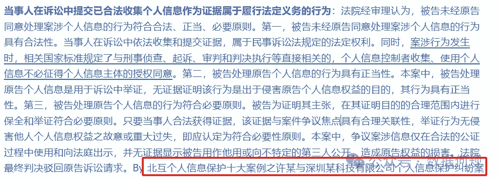

# 诉讼提交个人信息的合法性

> 来源：[https://docs.feishu.cn/docx/CPzFdbKRRoamqmxiPNAcoHs5nrd](https://docs.feishu.cn/docx/CPzFdbKRRoamqmxiPNAcoHs5nrd)

**-问：**基于诉讼、仲裁、调整等纠纷处理的需要，把个人信息给到律所、纠纷处理机构（法院等），属不属于“为订立、履行个人作为一方当事人的合同所必需”？

**-答1：**不是为履行法定职责或者**法定义务**所必需吗？

> 第六十七条 当事人对自己提出的主张，有责任提供证据。

> 《民事诉讼法》

**-答2：**主要是，到底是什么法定义务？哪个法说了，你必须要去诉讼、仲裁、调解？必须要请律师？原来我也一直认为是这一条，但是今天突发奇想又觉得不确定了。

**-答3：**看看这个案子

详见：[未经对方同意将合法收集的对方当事](https://mp.weixin.qq.com/s?__biz=MzU1NDk0NjE3MA==&mid=2247505868&idx=1&sn=eafc6e4e24bf6aa2fd4a02cb6e5d0b1e&scene=21#wechat_redirect)人个人信息作为证据向法院提交，是否侵权？

**-答4：**也可以看看这一篇：案例笔记：对外提供含个人信息证据的法律风险

**总结：各地法院裁判尺度不一，履行法定义务，**给法院提供依据充分，给律师提供还得找找。

[合法性基础](https://cbe8t1r4a5.feishu.cn/wiki/wikcnMO3dv4wwxpr7KunwIHHfwd)