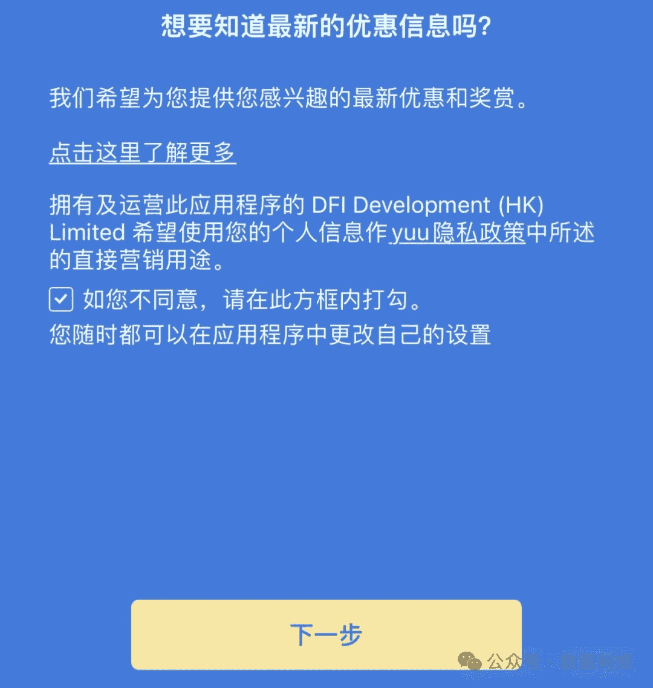
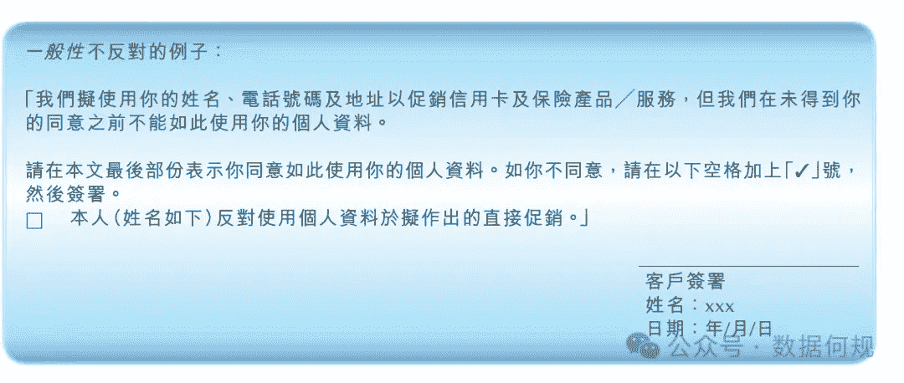
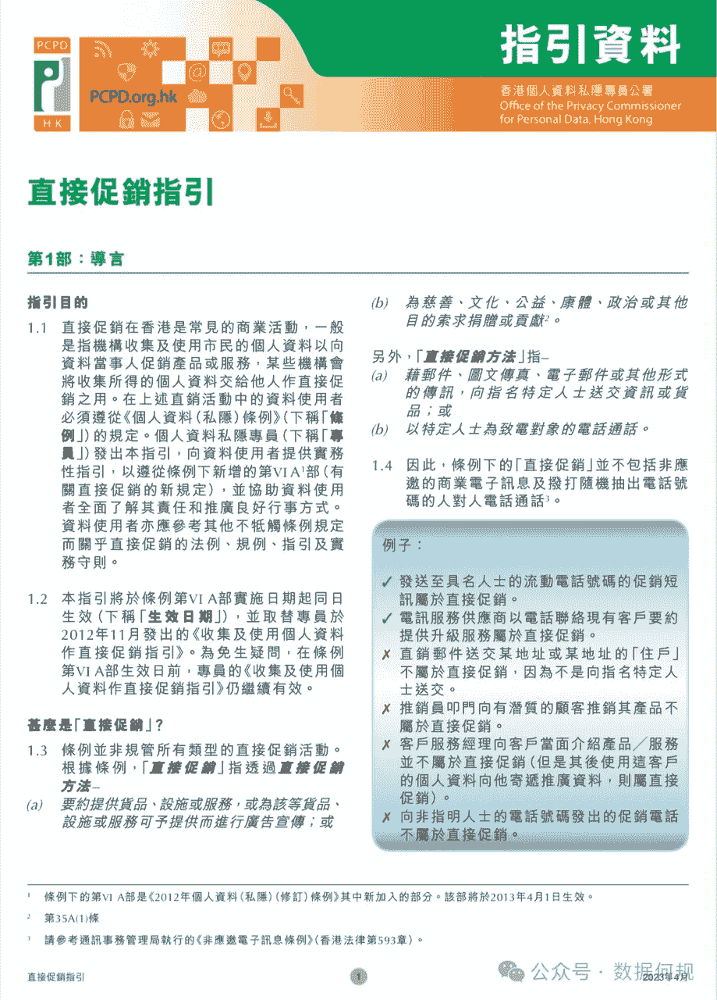

# 香港b2c营销的告知同意

> 来源：[https://docs.feishu.cn/docx/Cxamd77BhoAZ3Ox56sCcQYXdnHb](https://docs.feishu.cn/docx/Cxamd77BhoAZ3Ox56sCcQYXdnHb)

**-问：**灵魂拷问，香港这样这是opt-in还是opt-out?不过我截图截的不好，框应该是空的。

**-答1：** HK的都这么搞。

**-答2：**感觉这个勾如果不勾，用户同意的条款里是不是默认就会direct marketing？如果会，那在其他功能区域提供退订选项才是opt-out吧，注册流程里的这个勾等用户注册完也不能再去掉打勾。hk direct marketing不用active的opt-in吗？

**-答3：**我的观察是，香港可能把这种操作视同opt-in。注册时候，只要有选**择权，不**管是勾同意还是勾不同意，都算opt-in，之后再提供opt-out渠道。-答4：香港的促销指南允许这种形式。

**

-答5**：看到了，学习新知识**：一般性表示不反**对**。-答6**：在欧盟属于暗黑模式。在香港属于合法。在大陆属于欺诈误导。

总结：涨姿势，这样的勾选竟然是香港监管允许的。

[港澳台](https://cbe8t1r4a5.feishu.cn/wiki/CfL5w7AIiih0V4kNAyFcj5Ibn1b)

[合法性基础](https://cbe8t1r4a5.feishu.cn/wiki/wikcnMO3dv4wwxpr7KunwIHHfwd)