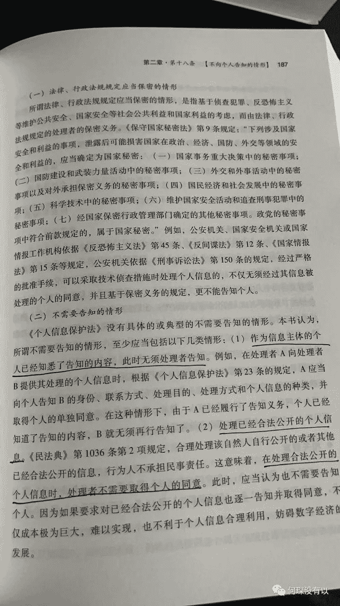
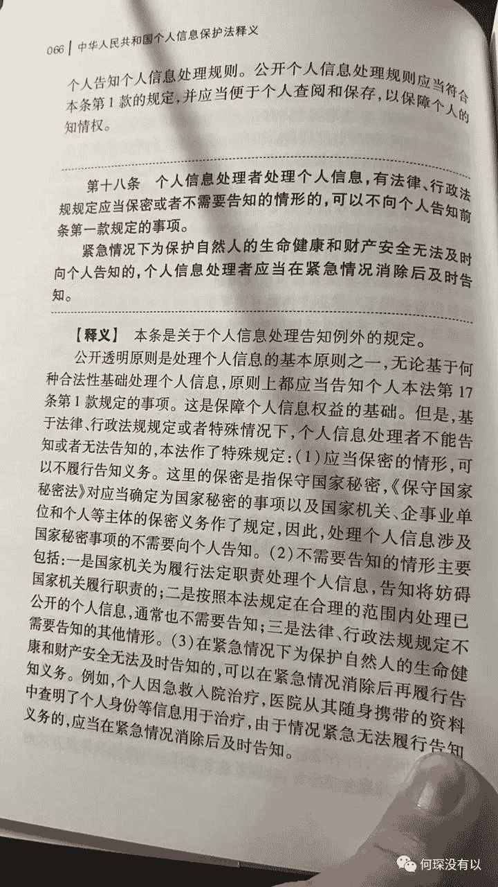
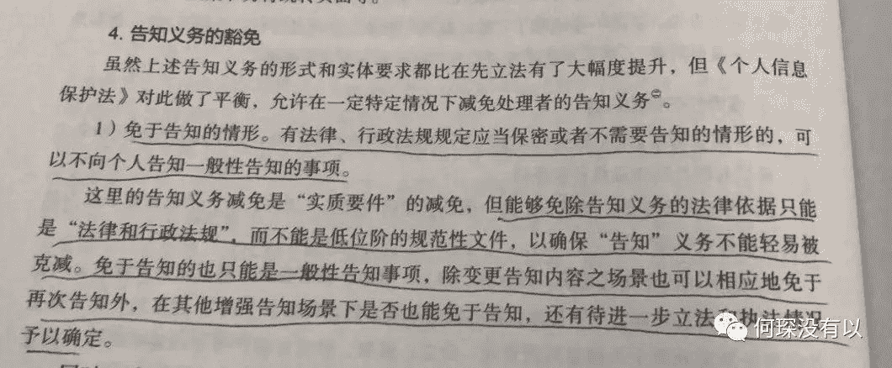

# 豁免告知的理解

> 来源：[https://docs.feishu.cn/docx/AYPodCZdHouJq1xTjj2cQQnMnnc](https://docs.feishu.cn/docx/AYPodCZdHouJq1xTjj2cQQnMnnc)

**-问：**关于《个保法》第18条第1款的理解：“个人信息处理者处理个人信息，有法律、行政法规规定应当保密或者不需要告知的情形的，可以不向个人告知前条第一款规定的事项。”

根据程啸老师和江必新老师的理解，“法律，行政法规规定”只用于限定“应当保密的规定”，而不限定“不需要告知的情形。我想问一下老师们，在下面两个场景中还需要告知吗？第一个是使用公开个人信息需要告知吗，如果处理者改变了原来是公开目的呢？第二个是招聘时投简历属于“不需要告知的情形吗？

**-答1：**我之前一直以为，无需告知，也是得法律规定的。按照程啸老师和最高院的理解，那感觉有些宽啊。

**-答2：**法工委杨合庆老师的观点如下：

**-答3：**法律法规规定肯定是**限定后面两种情况**：应当保密或无需告知的呀。实务中比较常见的场景有 利用企业公开的法人，股东，高管信息 进行营销推广活动，这算不算合理利用。

**-答4：**朱老师新书中观点如下。

[告知](https://cbe8t1r4a5.feishu.cn/wiki/MBURwAcGAikdAmkoOqJcwnmKnPh)