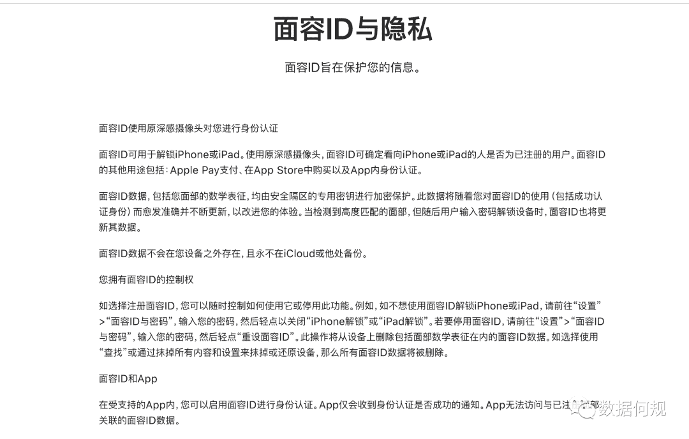

# 硬件采集信息是否需要披露

> 来源：[https://docs.feishu.cn/docx/XiuidaZyWoJWPIxQ8Q2calY7nhd](https://docs.feishu.cn/docx/XiuidaZyWoJWPIxQ8Q2calY7nhd)

**-问：**请教大家个问题，智能硬件终端（非手机终端）收集了数据，但这些数据只在终端处理不上传云端，这种算不算收集个人信息，是否需要在隐私政策中说明。跟同事在掰头这个问题，意见不一。

**-答1：**

——算采集，不算收集。

——**要**。

**-答2：**按35273的说法，不算收集吧。

**-追问：**请教下哈, 是在哪里说明"采集"和"收集"的区别的呢?

**-答3：**采集 更像是 读取；收集 更像是 拿走。

**-答4：**采集，比如**用户剪切板信息**？仅在设备终端做口令的格式匹配。

**-答5：**就**比如说终端**是个玩具机器人，收集了些图片信息，这些信息就在机器人终端采集终端处理，会传输到app，然后都不上传云端。

**-答6：**如果你在终端的处理是为了把个人信息去标识化，终端会自动把直接识别符或者去识别符删掉，终端传出的去标识化的数据不借助原识别符的话，不可能再重新识别甚至关联起特定个人的话，如果隐私政策不方便披露，我觉得问题也不大。但必须要证明终端是不会留存识别符的（无论直接识别符还是准识别符），相当于你们借助自动化的算法，在数据能进入到可控的环境里的时候，进来的就已经是这个环境里“匿名化”的数据了。

**-答7：**指纹、人脸都是存在终端的。

**-答8：**法律：可能算，可能不算，需要论证，35273:不算收集，监管：算收集，就看你信哪一个。

**-答9：**对**，如果是手机终端的话，调用接**口也会被检测到，即使是在终端处理，有些检测机构还会认定为收集。其他终端的话，隐私政策写上去再做个标注仅在终端处理不是更保险么。

[告知](https://cbe8t1r4a5.feishu.cn/wiki/MBURwAcGAikdAmkoOqJcwnmKnPh)

[技术概念科普](https://cbe8t1r4a5.feishu.cn/wiki/GfWtwCXWbiBzgQk1sxUcfFgXnSP)