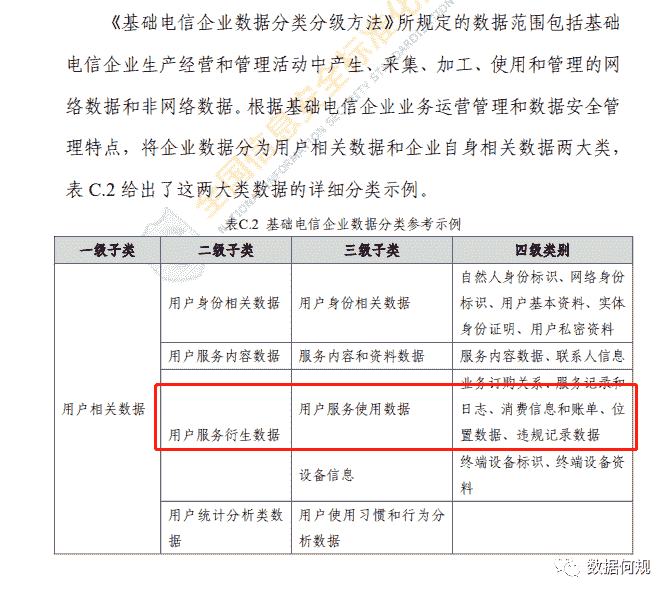

# 门牌号转经纬度的告知同意

> 来源：[https://docs.feishu.cn/docx/G3sqdbzF3oMkAqx88yjcMy2fnuf](https://docs.feishu.cn/docx/G3sqdbzF3oMkAqx88yjcMy2fnuf)

**-问：**请教个问题，将精确到门牌号的地址文本信息转化为经纬度信息属于新增收集个人数据吗？

**-答1：**不属于吧，应该说是新增对地址的处理和使用方式吧。

**-答2：****衍生数据**。要不要重新告知还是看是否超出之前的处理目的吧。

**-答3：**这个也可以参考。

总结：不属于收集新的个人信息，但个人理解还是要在隐私政策披露一下。

[告知](https://cbe8t1r4a5.feishu.cn/wiki/MBURwAcGAikdAmkoOqJcwnmKnPh)

[个人信息定义](https://cbe8t1r4a5.feishu.cn/wiki/wikcnwGGoWGzMNhr26Z4UO55xVF)