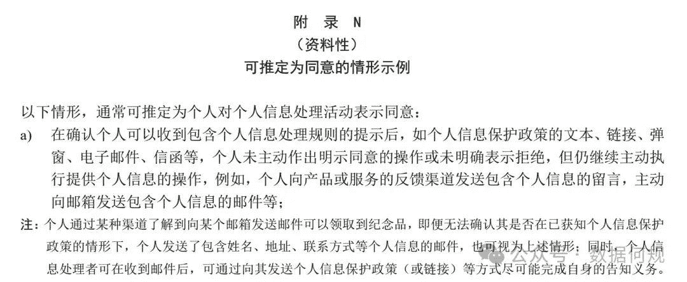
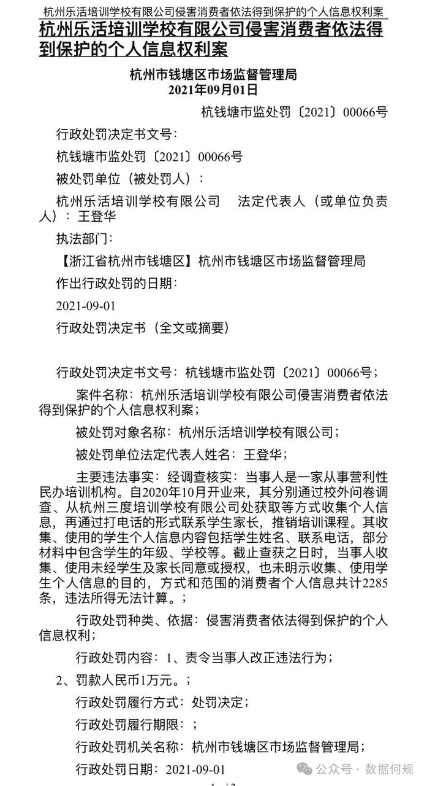

# 讲座报名告知同意

> 来源：[https://docs.feishu.cn/docx/RU0ndvmOdoryjWxHCDdclpCwnKd](https://docs.feishu.cn/docx/RU0ndvmOdoryjWxHCDdclpCwnKd)

**-问：**在线上发一些新品问卷，用户填写后可以抽奖派发礼物。我觉得问卷页即使不勾选或者没有一个数据采集的声明，但因为是用户自己手动填写的，应该也没有任何风险吧？

**-答1：**只能说**监管没有规制**，不能说没风险吧。你这不是个人信息处理行为嘛？

**-答2：**告知同意指南有个可以参考，但这样也要有个告知处理规则。

**-答3：**所有留资页面都可以引用这个？他只说了产品服务反馈渠道的回复和邮件回复这两个场景。调研不属于和这两个场景同等。

**-答4：****用****户提交只是代表“同意”动作，但是其他数据合规义务不能豁免**的：

1.C端页面需要有几句简短声明告知（问卷工具一般都会提供开放选项，可以写几句的、增强告知，但隐私政策链接加上就不一定了）；

2.B端与广告营销活动合作方或者问卷工具提供方要签署数据处理协议；

3.内部严格控制问卷工具后台访问和处理权限、数据处理活动全流程留痕。问卷后台就是个数据泄露的坑。

**-答5：****建议**动手打开一下问卷工具的填写表单页看看，一般总能写上几句话的，至少得说为了啥目的、谁收集、保证不会泄露啥的。这几句的法律意义在于“增强告知”，哪怕写得再简单，用户看了也放心。另外，在涉及第三方联动合作的场合下，还能够清晰告知划分责任主体。

虽少必要。另外不要被主动提交的“同意”动作所迷惑，毕竟，木有“告知”的“同意”也没啥用不是。

以上建议措还未包括**“必要性”评估**，这事儿另说。你会经常发现，业务小哥哥小姐姐创建问卷的时候，啥都想问，没啥必要性概念。呵呵，加上两句隐私声明要比减掉两个问题，容易太多了。至少问卷系统中涉及敏感个人信息的字段是需要逐条评估必要性的。

**-答 5：**这种必要性的认定感觉很难评估，**一方面要非常熟悉问卷涉及的业务内容，一方面问的问题多多少少都会**和业务沾点边，怎么认定必要性也是主观判断。

**-答6：**参加讲座要银行卡号这种肯定怎么解释也不行了。

**-答7：**还真有的，我有次参加X商会活动，是付了门票的，要填银行卡号，说为了发生退款用。其实是变相实名认证了。三要素了。

**-答8：**这种不应该实际发生退款需求时再收集么。

**-答9：**业务同事对于“必要性”的理解非常宽泛。请教法务生存技能，各位法务都怎样educate你们的业务，收集信息的范围和节点限缩在必要范围内啊？日常battle心好累。

**-答10：**让公安**网警**打电话给他，有本事你多收集。

**-答11：**有一些处罚案例。

**-答12：**合规这事儿就是从外而内，以上而下，有监管来上一课是最好使的，然后就是公司领导层得先认可和支持、发话，合规工作才能开展下去。董事会层一定得有强力支持合规的人，这样顶层上就有人说话，跟业务日常battle在所难免，但只要明面上顶层声音一致，法务合规总是可以占优势的，毕竟论讲道理咱们是专业的。合规教育是要年复一年，日复一日，case复case的，做好每年的training plan就好。

**总结：**

1.个人信息处理规则肯定要有，最好在页面简单说几句；

2.提交推定同意有论证空间，即可以不勾选，详见告知同意指南；

3.无论如何告知同意，必要性论证是更前置的环节。

[告知](https://cbe8t1r4a5.feishu.cn/wiki/MBURwAcGAikdAmkoOqJcwnmKnPh)[合法性基础](https://cbe8t1r4a5.feishu.cn/wiki/wikcnMO3dv4wwxpr7KunwIHHfwd)