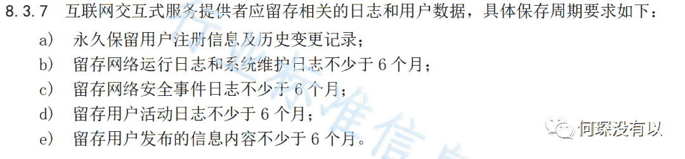

# 用户如何行使删除权

> 来源：[https://docs.feishu.cn/docx/Gbdvdz3Aho7EdmxBby2c3tEEnfe](https://docs.feishu.cn/docx/Gbdvdz3Aho7EdmxBby2c3tEEnfe)

**-问**：我报名某个讲座，并说明“请确保本人个人信息仅用于本次讲座报名，讲座结束后请及时删除”。客服回复我：“注册信息是没有办法删除的。”这个合规吗？

**-答1：**注册信**息根据公安部**行标标《互联网交互式服务安全管理要求 第1部分：基本要求》需要永久保存。

**-答2：**客服：“删除？注册信息没法删除”，可能有以下原因：

（1）搪塞用户（考虑留存率及后续营销、 BD需要）；

（2）从来没人提过删除，第一次遇到呢，不好意思，不想搞；

（3）有各种法规要求“XX日志不少于六个月”呢，所以不能删您的注册信息呢

事实上**，日志只是**一个很基础的**信息，即“**某年某月某日几点几分几秒哪个用户做了一个什么事情（如注册了账号），这个日志信息只是记录了这么个事情，日志信息不能等同于具体的用户注册信息。日志信息更加笼统，通常没有注册信息那么详细的字段。因此，这种情况也是不太站得住脚的。因为，一线客服不太可能有这种专业知识，并且这种解释不一定能支撑这种业务场景。从截图内容看，像是在线研讨会之类的活动，非金融交易，不像是反欺诈/反薅羊毛之类的需求，留存用户注册信息的业务必要性不是那么明显。退一步讲，即便要留存，是否也有必要向用户详细说明一下原因，并保证虽不能删除，但至少保证停止处理。

虽然，公安部有个行标《互联网交互式服务安全管理要求 第1部分：基本要求》要求注册信息永久保存。但：

**（1）从效**力上讲，显然行标的效力显然不如《个保法》，甚至比35273这种推荐性标准还要弱一些，更别提强制性标准。

（2）截图这个场景，而很可能是用一个普通的在线表单登记参加活动人员的场景。虽然也用了个系统（姑且算是互联网交互式服务），但这个系统肯定不如那些具有“舆论属性和社会动员能力”的系统那么重要。若用户较真起来，我不认为该平台有多少胜算。因此，这个行标是否适用于这个系统以及效力几何可能还是个问号。

**-答3：**那个标准写的是日志和用户数据，不单只是日志。网安领域效力级别和普通领域的不一样，行业标准优先国标的很常见，比如等保，有的时候团标比国标还有用。你可以在去看下法条，写的是符合国家标准的强制要求，而不是符合强制国家标准的要求。

**-答4：**法规标准之间掐架也是有可能的。留存有留存的理由，删除也有删除的依据，要结合具体业务场景看如何解释和运用了。

**-答5：****就这个c**ase而言：（1）收集注册信息的保存时限有无明确要求，我理解这**是提及47条需要的**一**个前提；（2）客**服话术而言，要他穷尽各项信息如何处理不现实，最多只能做到哪些信息是固定要求的进行回答；（3）其他信息可能需要法务合规给出专门指导意见，这样感觉每次企业做一个无论大小的可能收集个人信息的活动，都需要提前做好预案；（4）参考隐私政策里面15个工作日的回复要求，这些应对客户提出要求的内容都需要提前做出预案呀，否则根本来不及。当然我觉得这些可能也是做几次之后就会形成固定模式能应付大多数场景了。

**-答5：**昨天那个场景如果是在类似问卷星或者其他**h5页面填**写个人信息的话，严格来说可能**都不**算是注册（个人理解），应该只是简单的留资。

[数据存储期限/删除](https://cbe8t1r4a5.feishu.cn/wiki/wikcn8Aer4sxhSSdwFLSX8UQrCb)

[个人信息主体权利](https://cbe8t1r4a5.feishu.cn/wiki/NlHiwgnN3igX5okLEfwc5Osmnab)