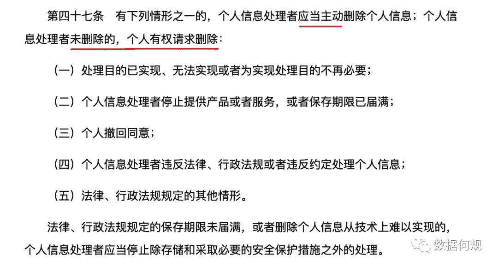

# 撤回同意后个人信息的删除

> 来源：[https://docs.feishu.cn/docx/ISaOdTRlNoRu1vxgJLBcG4zCnug](https://docs.feishu.cn/docx/ISaOdTRlNoRu1vxgJLBcG4zCnug)

**-问：**如果数据主体要求撤回同意，但没有明确要求删除，之前处理的数据是否需要删掉呢？

**-答1：**个保法第45条说得很清楚，应该删除。没删还可以要求你删。

**-追问：**那怎么理解撤回同意不影响之前的处理活动呢？

**-答2：**对个人信息的收集、使用和存储。

**-答3：**想起来有个corner case个人信息主体撤回同意后一段时间 又再同意处理的 对于撤回同意之前的数据怎么处理？

**-答4：**撤回了就删了，找回来了才麻烦把。

**-答5：**见过有的设置了**冷静期**，一定期间内可以反悔。

**-答6：**他的意思是，可能没彻底删，只是逻辑删除了。缺乏对已撤回同意数据进行处理的合法基础。

**-答7：**在**云服务**的场景下，对于用户内容数据一般会设置宽限期和保留期，如果客户没有付费了，根据客户的等级或协议约定进入相应的宽限或保留期，但毕竟留存数据也是成本，再过了就真不会留存，资源释放了。

**-答8：**确实，如果只是忘记续费会员立马就把人云盘**里东西删掉了，就**等着吃官司吧。可以扒一扒百度网盘、阿里云的用户协议隐私政策。

**-答9：**恢复已经没有合法性根据的数据处理的（即便是误**删**除）是一个还蛮delicate的问题，一方面考虑法律基础和技术成本，另一方面也要考虑向用户传递的信息和道德风险（会不会让用户误认为平台在偷偷摸摸留存数据）。立刻一删了之当然是最简单直接的做法。

总结：一边是法定义务，一边是客户的需求，难。

[数据存储期限/删除](https://cbe8t1r4a5.feishu.cn/wiki/wikcn8Aer4sxhSSdwFLSX8UQrCb)