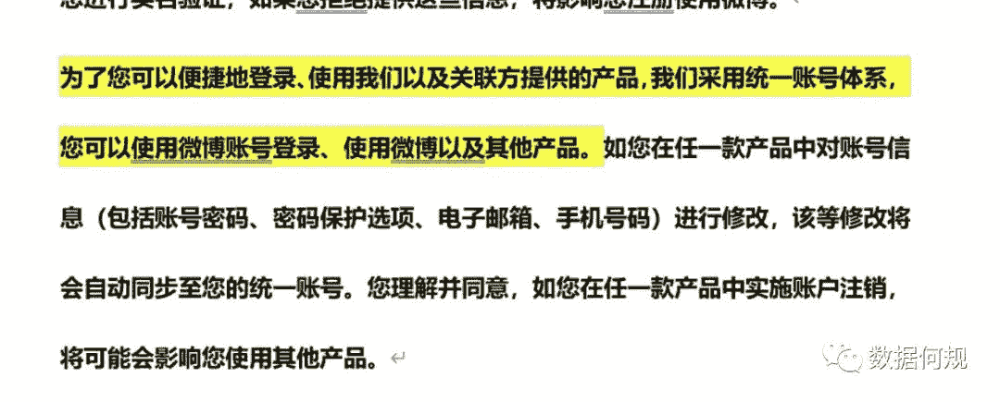
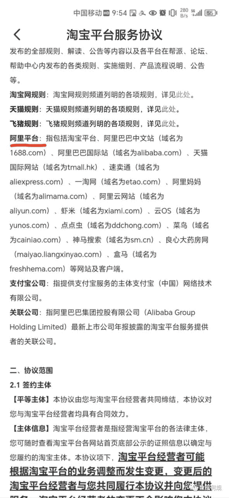

# 统一账户体系的合法性基础

> 来源：[https://docs.feishu.cn/docx/Xo00dwnqXo7tLSxSdM7cT8eDnzb](https://docs.feishu.cn/docx/Xo00dwnqXo7tLSxSdM7cT8eDnzb)

**-问：**这个是微博的隐私政策，这个强制账号关联是可以的嘛？那当时微信读书那个案子罚的啥？或者说，微信账号，用在微信读书登录，为啥还要勾选问一遍是不是同意用微信账号登录？如果强制统一账户系统，那如果要注销一个平台上的账户，其他平台账户不注销，咋整啊？

**-答1：**这不都这么做么，淘宝的协议里也是一揽子授权淘宝平台下的账号：天猫，菜鸟，闲鱼一堆，只不过会二次注册。

**-答2：**可以选择注销单个服务，参考滴滴。

**-答3：****国标3**5273第8.5注2对这种账号注销有方案的，简单说就是切断账号关联+删除应用数据。不限于是否是统一主体运营的产品。通常对“关联方”应该有定义。创建一个中心账号，只是创建了一个身份标识，≠同时默认创建了使用该账号登录的每一个应用下的用户账号身份、自动变成这些应用的用户。

**-答4：**统**一账号的合法性基础可以是告知同意或者合同，一般会有一个单独的隐私政策或者用**户协议来说明内部如何打通的。多产品线时就会遇到这个问题，例如平安系。目前实务实践是这样的，你可以研究一下平安保险系，典型之金管家。同一个账户底层user ID有互通，但数据是隔离的。

**-答5：**这个就是为啥要二次注册的原因了，可以理解为注册这个动作“激活”了关联方的这个账号，合法性基础倒是没有特别深入研究，实操中我们是用协议条款告知的方式。A平台开了a账号，一揽子授权给 A 平台关联的 多个应用，比如 B 应用。当你使用 a 账号登入 B 应用的时候，B 应用底层是已经有了 a 账号的身份标识了，但仍然会让勾选 B 应用的用户协议和隐私政策。微博这个没有淘宝和平安金管家的用了列举式的清晰，所以对这个关联方会有质疑。

**-答6：**就是虽然是统一账户，但不同app或者不同业务的数据一般都分开存储，不是混着的，除非业务必要并且有告知共享的，内部才共享。

**-答7：**这问题得从产品形态和账户关系入手、统一账户、授权、关联。权利是成对出现的。统一账户，注册-注销、授权-取消、关联-解除。需要注意的是其实很多看似统一账户，底层逻辑是关联。

**-答8：**实际上还是因为底层是一张表，跨平台统**一账户背后是技术逻辑而不是法律逻辑**导向。我们没办法用一个21年生效的法律去回溯一个10年前推技术中台时期的决策呀。

**-答9：**数据部门：改表结构最艰难了，不知道什么时候会冒出来一堆乱七八糟的勾稽关系。

**总结：历史问题。**

[账户注册/注销](https://cbe8t1r4a5.feishu.cn/wiki/wikcn7NWTsw2CDopTUC6JtHBRyf)

[合法性基础](https://cbe8t1r4a5.feishu.cn/wiki/wikcnMO3dv4wwxpr7KunwIHHfwd)

[对外提供](https://cbe8t1r4a5.feishu.cn/wiki/wikcnKiT2Zx8SW3B6K4rfGKmXee)