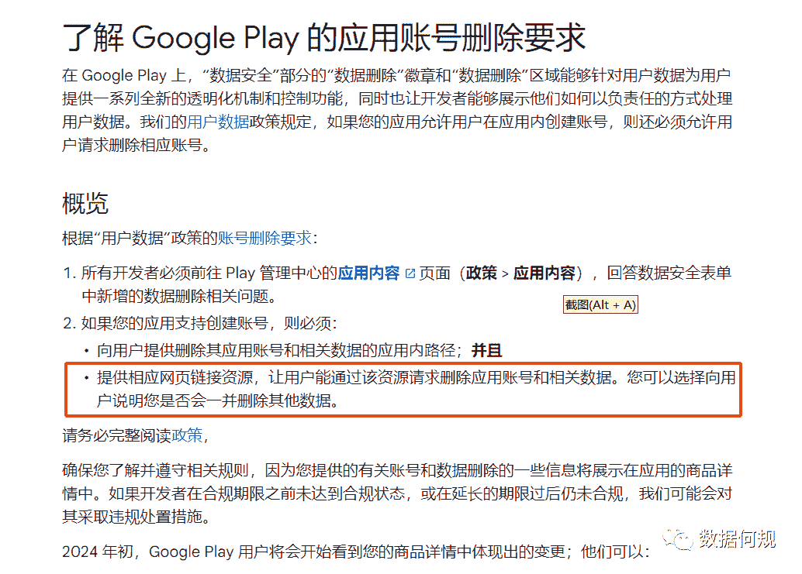

# Google Play销户要求

> 来源：[https://docs.feishu.cn/docx/B5pNdV9ksooMNrxhc0ucLT1pnsc](https://docs.feishu.cn/docx/B5pNdV9ksooMNrxhc0ucLT1pnsc)

**-问：**这里google play政策里写的“提供相应网页链接资源，让用户能通过该资源请求删除应用账号和相关数据”怎么弄啊？业务找我求助，说google play用这个卡上架，要求在表单里填一个链接，这个链接要能让用户删除账号和数据。之前没碰过这种情况呀，我理解不是只要在APP里有删除账号的路径就可以了嘛？

**-答1：**路径+用户请求删除账号的链接，谷歌实质审查表单这个链接能否实质上实现删除。有路径不一定能实质达到删除。

**-答2：****这是**Google Play十一后的新要求。我们是单独做了个网页，前端大概交互是“用户登录--用户确认删除范围--邮箱二次确认身份--删除结果邮件反馈”，后台怎么配置需要和开发商量。不涉及精细化处理的，后台比较简单，如果后台能够支持，可以参考谷歌账号做精细化删除(分产品/数据类型) 。

**总结：出海不好做啊。**

[账户注册/注销](https://cbe8t1r4a5.feishu.cn/wiki/wikcn7NWTsw2CDopTUC6JtHBRyf)

[APP](https://cbe8t1r4a5.feishu.cn/wiki/wikcnm7SSi199OdP5q0UAot3Fsf)