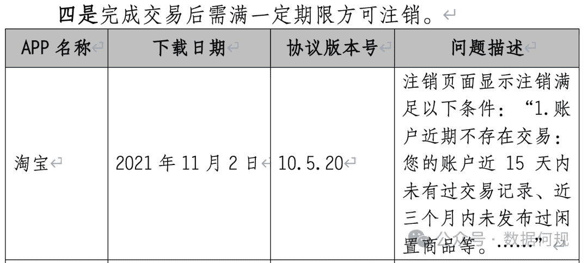

# 注销反悔期

> 来源：[https://docs.feishu.cn/docx/FAGHdmrrLoldlmxpgolcrf7anti](https://docs.feishu.cn/docx/FAGHdmrrLoldlmxpgolcrf7anti)

**-问：**请问下大家，关于账户注销的反悔期，有强制的要求吗？

**-答1：**一般的没有吧（从实践反推），强监管领域会有吗？如金融。

**-答2：**看各地监管尺度自行决定，**有的地方监管不允许强制设置**或默认设置反悔期，有的允许设置。从账号系统开发和客服工作简单化而言，注销之后不再恢复是比较好的，但为了避免用户纠纷和反悔，要在注销流程中做多次增强告知提示，注销流程周期可以长一些（但最长15日，不是15个工作日），注销结果和账号权益损失告知清楚。如果仅仅为了维护用户量而强制设置反悔期而且没有明确告知，有些得不偿失，还是会有不小的监管侧风险（例如被认为是假注销）。

**-答3：**淘宝因为这个事，我记得被**全国消协通报过**。详见：http://m.cca.cn/zxsd/detail/30315.html

**总结：不弄冷静期最好。**

[账户注册/注销](https://cbe8t1r4a5.feishu.cn/wiki/wikcn7NWTsw2CDopTUC6JtHBRyf)