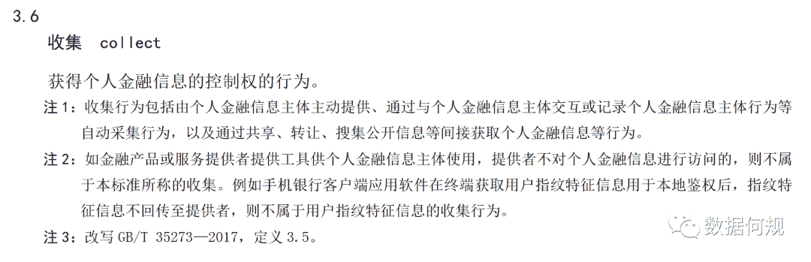

# 对“收集”的理解

> 来源：[https://docs.feishu.cn/docx/EGqOdAKy4o9CqHxisyocp7X1nzc](https://docs.feishu.cn/docx/EGqOdAKy4o9CqHxisyocp7X1nzc)

**-问：**请教下大家，关于数据“收集”的准确定义和监管态度，有相关的文章分析吗？35273规定，如果产品或服务的提供者提供工具供个人信息主体使用，提供者不对个人信息进行访问的，则不属于本标准所称的收集。例如，离线导航软件在终端获取个人信息主体位置信息后，如果不回传至软件提供者，则不属于个人信息主体位置信息的收集——那是否可推断如果数据不上云或者不回传，就不属于收集数据呢？还是说即使不上云/不回传，但是技术上可行，就属于收集数据。

**-答1：**监管趋向于——本地使用：采集；云端回传：收集。数据不出设备，不算收集。

**-答2：**如果只是存在车的本地，车企有没有办法获取该等数据，是否能够决定该等数据的处理目的呢。感觉，个保法没有对这个作进一步的解释，35273的理解还有效吧。所以不上云or不回传，就不算收集。

人行的标准也是这个逻辑。

**-答3：**采集和收集啥区别啊？意思不出设备就无法接触到数据？就好比我提供一个离线工具给你，你自己玩自己用，我碰不到也没关系。

**-答4：****不出设备**就不决定处理方式和目的？不是处理者？不履行义务及合法性透明性？恐怕不是吧。非收集的处理活动。

-答5：我觉得“采集”这块不影响个人信息处理者的认定，但影响“收集”的是什么信息。我按我的理解，举个例子，不一定对，请各位老师也帮忙看看。假如端侧采集人脸信息，但个人信息处理者的目的不是为了“识别到特定个人”，只是想做群体属性分析，所以个人信息处理者没必要把人脸传回云端，只要看群体的特征值，比如年龄—青年人、性别—女，而这样的结构化数据回到云端之后，是无法再推回特定个人的，所以个人信息处理者没有“收集”人脸信息，但需要就这段处理的技术情况、特别是端侧人脸信息不出本地、如何删除做好说明。

**-答6：**本地鉴权后，可能只是要素匹配完后回传是或否，个人理解不属于实际收集了指纹特征信息，不能等同，但得说明清楚存储删除各项处理的方式，确保知情权。

**-答7：**没说不履行义务及合法透明性，就是在说采集和收集的区分，以及区分的关键特征是否是对个人信息取得控制权。即使是采集，也应该要明确告知的。我理解控制是不通过个人信息主体即可自行执行具体的处理，包括使用、共享、转让等。

**-答8：**境内法语境下，采集等同于收集。个人信息控制权 顾名思义就是支配权，即基于处理者（controller）的意志或者目的进行访问、使用、传输等去处理。个人信息2个判断路径——识别和关联，在特定场景下符合的，无论直接标识符还是准标识符，都可能属于个人信息。

**-答9：**这里存在若干相互交织的开放问题。一是是否可以、或者说是否应当对每个处理（活动/行为）界定（共同）处理者。二是信息主体是否可以、如何可以作为处理者，以及作为处理者时如何与个人与家庭例外相调和。三是界定处理者的“处理方式”的适用，及其与“处理目的”的共同适用如何进一步细化。四是（仅）在终端设备上发生的处理是否仅因此即具备特殊性，比如需要优先适用《民法典》/e-Privacy Directive，等等。这些问题可以在比较意义下展开分析，但笃定的回答可能还是需要一定的信念成分。此外，数据表征的定性也是目前重要且有趣的开放性问题。

**-答10：**我认为采集或收集的讨论无非是标准适用的问题，不影响处理者的认定。问题是谁是处理者及相互的角色和义务。

[收集/使用/处理](https://cbe8t1r4a5.feishu.cn/wiki/wikcnQktN4CZxJR45N7TVd1cqld)