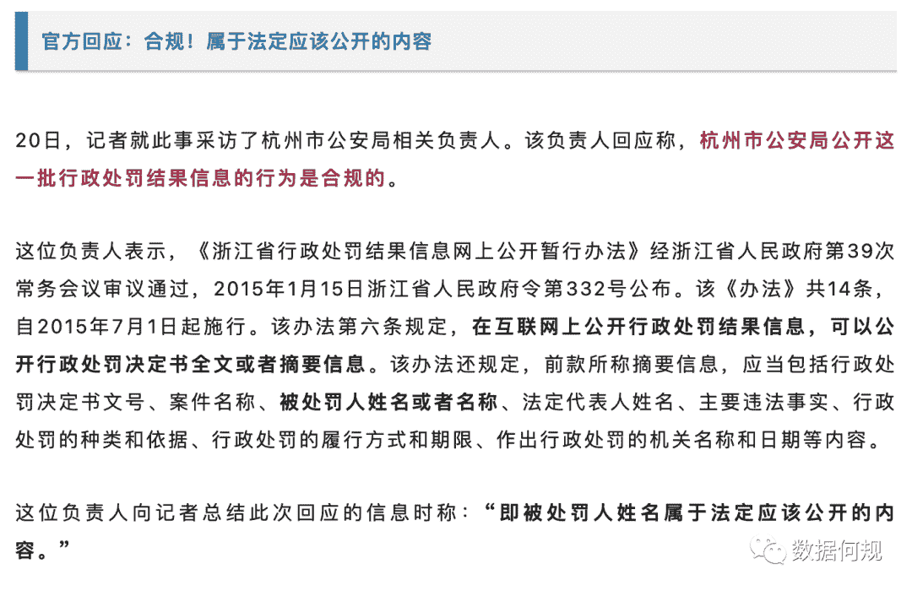

# 公示咸猪手名单

> 来源：[https://docs.feishu.cn/docx/EHhRdyJjmoZpKPxOPQ6cRJTanVf](https://docs.feishu.cn/docx/EHhRdyJjmoZpKPxOPQ6cRJTanVf)

**-问：**如何看待杭州警方公开咸猪手名单？详见：公开“色狼”姓名侵犯隐私？当地警方回应

**-答1：**就个保法而论，应该不妥当吧。。只是法律本就是为老百姓和政府服务的。。老百姓和政府对这事的态度都是叫好的。。所以这帮色狼算倒霉。。

**-答2：**不止一次了，之前也上过新闻。

**-答3：**我**记得有个规定说过，公开的法律文书应该只显示公民**姓氏的。《公安机关执法公开规定（2018修订）》第十四条向社会公开法律文书，应当对文书中载明的自然人姓名作隐名处理，保留姓氏，名字以“某”替代。

**-答4：**要很多地方路上闯红灯还直接公示照片呢，之前董明珠照片放公交车上也被公示闯红灯。

**-答5：**个人认为法律上依据是不足的。《浙江条例》不是法律，不能限制个人隐私权利吧。

总结：严格遵守行政法比例原则即可。

[公开](https://cbe8t1r4a5.feishu.cn/wiki/DYLZww9rMit1Plkg1rtcv351nOb)

[单独同意](https://cbe8t1r4a5.feishu.cn/wiki/wikcnJE9n6JylcRx7c3La4Yjahd)

[合法性基础](https://cbe8t1r4a5.feishu.cn/wiki/wikcnMO3dv4wwxpr7KunwIHHfwd)