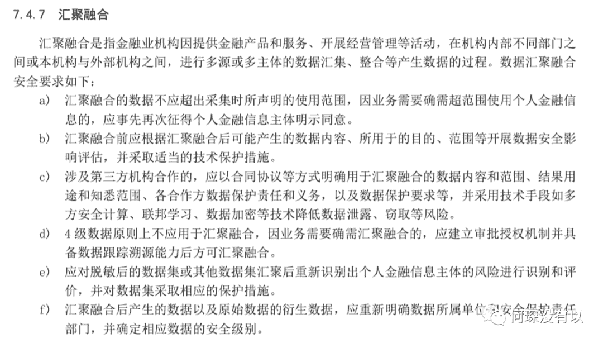

# 数据融合和共享的区别

> 来源：[https://docs.feishu.cn/docx/RwpLdQ7OEoypZ3xmyViclcu7nee](https://docs.feishu.cn/docx/RwpLdQ7OEoypZ3xmyViclcu7nee)

**-问：**集团内容的数据汇聚融合，与数据共享有何区别？我个人感觉数据汇聚融合的过程，实际上离不开数据共享，但是看到很多地方提示两者是不同的。

**-答1：**个人感觉数据融合是数据共享后可能的后续处理动作。拿过来是共享，是不是和我的数据放一起是融合。

**-答2：**可参考金融行标的定义。

汇聚融合与共享在概念上应该是**交叉关系**。集团内部的汇聚融合导致数据出主体的，也同时构成数据共享，适用个信法第20条、21条或23条的规定。

**-答3：**可以看看这篇：[万字长文说“数据融合”](https://mp.weixin.qq.com/s?__biz=MzA4NDMzNjMyNQ==&mid=2653146955&idx=1&sn=b0543e8d736f9f98f131a10f6ce6140f&scene=21#wechat_redirect)。

[对外提供](https://cbe8t1r4a5.feishu.cn/wiki/wikcnKiT2Zx8SW3B6K4rfGKmXee)