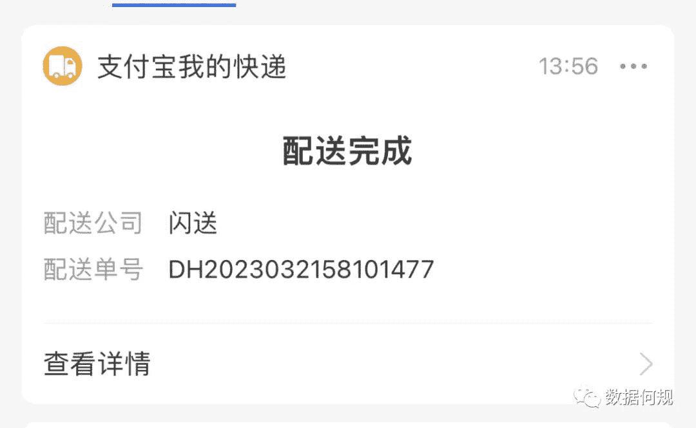

# 微信、支付宝共享订单合规性

> 来源：[https://docs.feishu.cn/docx/G7XcdVg6WoJeVZxS57FcdomRnGc](https://docs.feishu.cn/docx/G7XcdVg6WoJeVZxS57FcdomRnGc)

**-问：**我在小程序登录闪送后下单，订单完毕后支付宝也收到了消息推送，这合规吗？

**-答1：**很正常，前天淘宝刚下单几套西装，然后微信朋友圈广告一直给我推，连款式都一样。不知道怎么实现的。

**-答2：****输入法、剪贴板**都有可能，或者上了**联盟**。

**-答3：**类似cookie的**idfa、OAID**等等广告营销用设别识别码是可以做到的。

**-答4：**可能是菜鸟裹裹，我没有仔细研读过协议，但据我观察也不是所有的**快递公司的快递信息都会被**支付宝推送。盲猜菜鸟裹裹联盟里的会被推送（已经授权过了），但是不在联盟里的我们收不到。

**-答5：**支付宝/微信小程序只是接入闪送服务的不同途径，最终提供服务的还是闪送，所以在闪送下面注册的账号，无论在什么平台登录都是一个**账户体系**下的，它能在微信和支付宝通知里推送，应该是微信支付宝都绑定了同一个闪送的账号。猜测是这样，具体还是看闪送的服务协议比较清楚。

**-答6：**支付宝或者微信小程序都可以看成域名指向唯一的移动页面，app也行，这几个小程序/软件**/网页 之间登录信**息互通合情合理。但是闪送账号 微信/支付宝账号 快递信息之间的授权链条感觉有点长。

**-答7：**感觉可以发封邮件让闪送解释一下。

**总结：我不理解，等我发封邮件。**

[对外提供](https://cbe8t1r4a5.feishu.cn/wiki/wikcnKiT2Zx8SW3B6K4rfGKmXee)