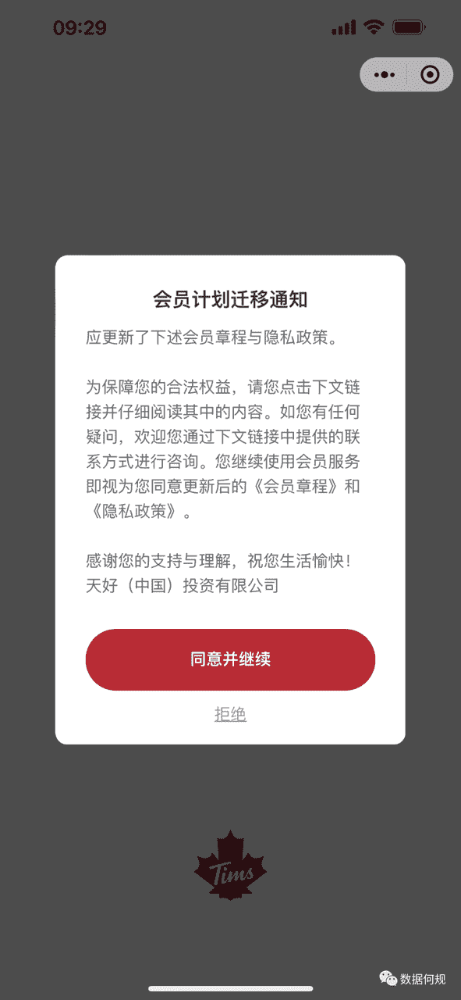
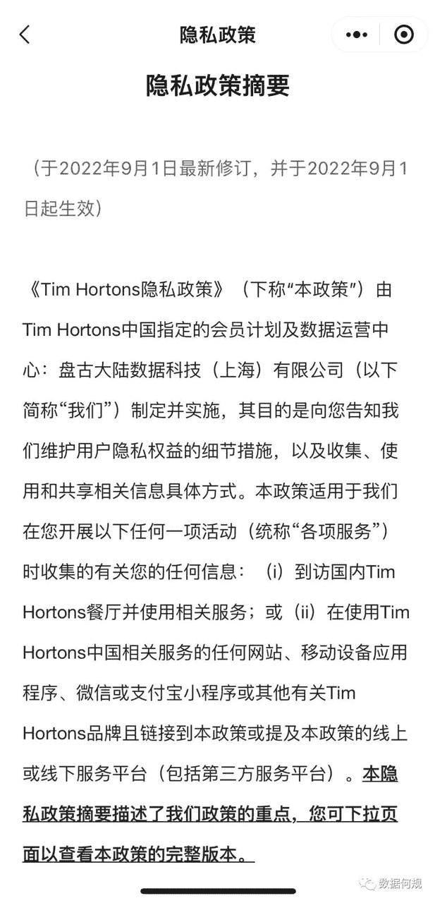
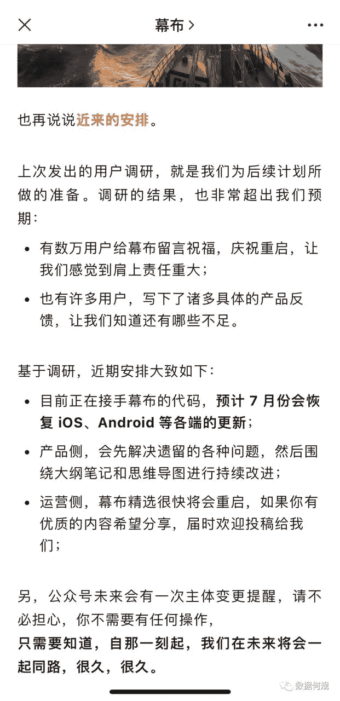

# Tim's会员转移

> 来源：[https://docs.feishu.cn/docx/MP6QdXtIzoPGBxxHQLgcWR3an8f](https://docs.feishu.cn/docx/MP6QdXtIzoPGBxxHQLgcWR3an8f)

**-问：**Tim‘s会员转移告知算获得同意了吗？如果按拒绝会咋样啊？

**-答1：**拒绝或未点击同意，对迁移的实施有哪些影响，理论上是否点同意的相关数据才能迁移。实操很繁琐。能否可以加密后整体迁移，再将点同意的数据进行解密激活。运营主体变更进行会员迁移不算转移。

> 个人信息处理者因合并、分立、解散、被宣告破产等原因需要转移个人信息的，应当向个人告知接收方的名称或者姓名和联系方式。接收方应当继续履行个人信息处理者的义务。接收方变更原先的处理目的、处理方式的，应当依照本法规定重新取得个人同意。

> 《个保法》第22条

**-答2：**不需要获得同意吧，履行告知义务就好了。

**-答3：**原版本就披露CRM运营商了。

**-答4：**为啥不需要同意啊？个保法22条没写这种情况啊？要符合个保法22条，要怎么证明是合并，分立，解散，被宣告破产哪？

**-答5：**这里好像**没有分立的感觉**。。不过🛰️👸号迁移，也是**opt out**。

**-答6：****幕布**被并购，然后发了一个告知信，以后有其他团队运营。我理解用户如果不同意新主体控制他的数据可以主动注销，否则商业上的并购，拆分还要逐一获得用户同意，这不符合实际也没有可行性。不是并购，像是集团体系下拆分数据的做法，不过对于用户都是新主体了。如果新主体能继续保持原有的数据安全水平，没有减损用户利益，这种直接告知不用非得同意的做应该不会被太挑战，反正以前是这么做过。

**-答7：****本来是委托处理，出**于某种目的想把数据处理者变成盘古，但实际上因为业务需要tims不可能不是数据处理者，费解这个迁移能实现什么业务目的。

总结：似乎这个弹窗也可以算是单独同意了。

[对外提供](https://cbe8t1r4a5.feishu.cn/wiki/wikcnKiT2Zx8SW3B6K4rfGKmXee)