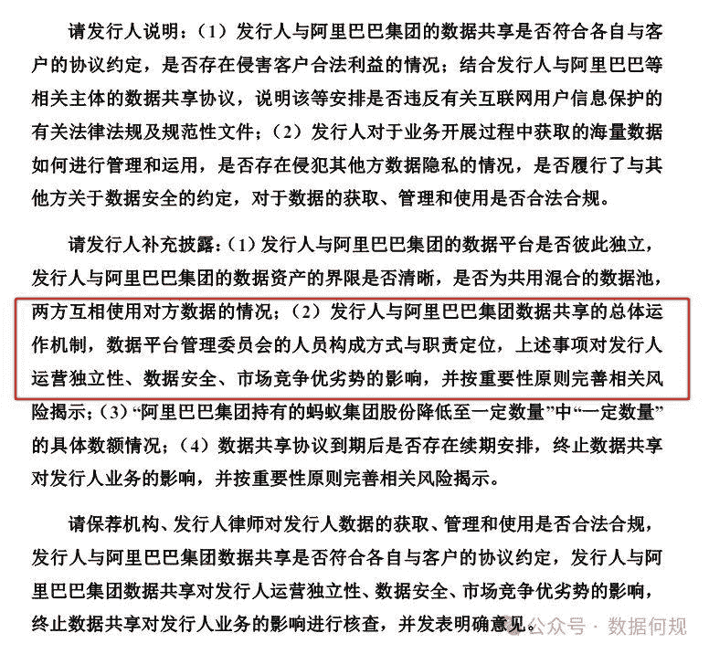

# 集团数据融合

> 来源：[https://docs.feishu.cn/docx/NoDCdRndUoQtkNxFIvqcg0PcnJf](https://docs.feishu.cn/docx/NoDCdRndUoQtkNxFIvqcg0PcnJf)

**-问：**各位大佬，求教下，有没有对集团内数据共享/融合的相关资料？或者相关标准？我看之前蚂蚁答复证监会问询的材料也不是很详细。我看其实也没明确的法规不允许啊..而且大集团数据融入不是趋势么？

**-答1：****央行对金融控股**公司有管理办法，其中涉及这个，但是也是很严格的。不会突破个保法。

**-答2：**金融监管有要求建立集团内部信息共享防火墙制度，风险隔离。

**-答3：****金融机**构数据共享很常见的，尤其是黑名单的联合维护和共享。

> 金融机构应当在总部层面制定统一的反洗钱和反恐怖融资机制安排，包括为开展客户尽职调查、洗钱和恐怖融资风险管理，共享反洗钱和反恐怖融资信息的制度和程序，并确保其所有分支机构和控股附属机构结合自身业务特点有效执行。金融机构在共享和使用反洗钱和反恐怖融资信息方面应当依法提供信息并防止信息泄露。

> 《金融机构反洗钱和反恐怖融资监督管理办法》第12条

>

**-答4：**供参考。1.[金控集团数据共享研究（上）](https://mp.weixin.qq.com/s?__biz=MzI4Mzk4MTMzNQ==&mid=2247547453&idx=1&sn=b047cce7ef85188f7bff10d4514adb52&scene=21#wechat_redirect)2.[金控集团数据共享研究（下）](https://mp.weixin.qq.com/s?__biz=MzI4Mzk4MTMzNQ==&mid=2247547460&idx=1&sn=3f8fd5e0937f5bbff54b046b89ebfd7e&scene=21#wechat_redirect)

**-答5：**1.数据共享需遵守个保法和数安法，这一点就可以限制绝大多数的集团共享；2.行业数据管理的监管规定；3.关联交易的限制反而不是强限制。

总结：不能突破个保法，平安有一些实践做法，但也很难说没有瑕疵。

[数据/个人信息共享](https://cbe8t1r4a5.feishu.cn/wiki/wikcn71ZZcOp5QrI77kgikS5Opr)