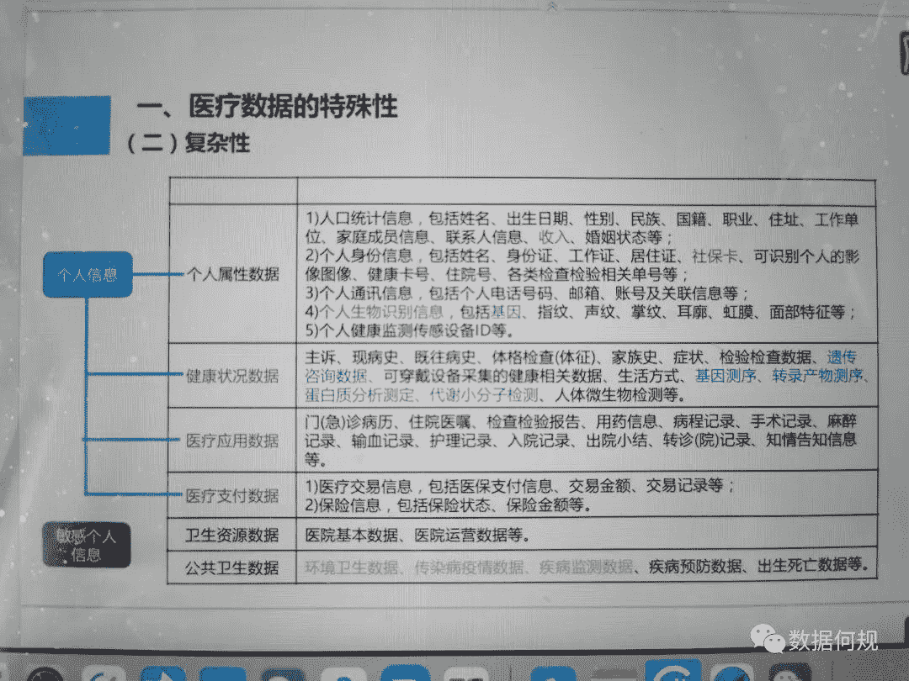
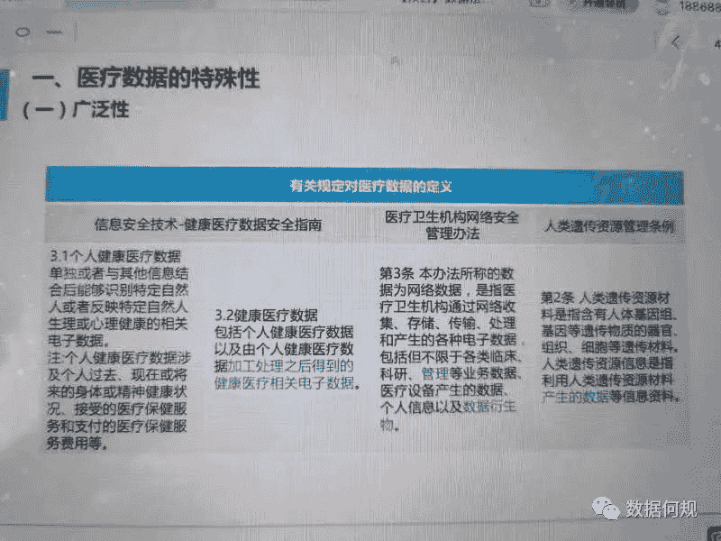

# 健康信息委托处理的认定

> 来源：[https://docs.feishu.cn/docx/HkFAdaoooohnpfxZNkscVrdJnjg](https://docs.feishu.cn/docx/HkFAdaoooohnpfxZNkscVrdJnjg)

**-问**：公司A收集用户的手机号和心率、心电图等数据，为了分析心电图是否有异常，会把心率、心电图等数据（不传输用户手机号）发送给公司B做分析，然后获取公司B分析结果。这个时候，对于公司B来说，拿到的心率和心电图数据没有关联到个人，算是处理个人信息吗？如果不算，那公司A是不是也不算是委托公司B处理个人信息？

**-答1：**举个极端例子，众所周知，某个波形图的心脏病人，全国仅有一例。所以单纯一个心电图也是个人信息。

**-答2：**委托处理个人信息是站在委托处理者的视角下判断吧。

**-答3：**这个问题可以这样理解，参照金融的标准《金融数据安全 数据生命周期安全规范》里面明确提到了对x级个人信息委托处理方处理前要脱敏一下，但这并不意味着受托方处理的这些数据就不被视为是个人信息了。

**-答4：**你不能说B识别不出来，就不是个人信息。万一B泄露了，第三方识别出个人，即使不识别可能侵害个人权益，A不背锅。

**-答5：**这都是去标识化手段，不是匿名化。

**-答6：**以下PPT供参考：

**-答7：**A是处理者，这些数据是病人医疗信息的一部份，我觉得算个人信息的，这个性质去到受委托方那里也不会变啊。受委托方就依据合同约定履约。

**-答8：**个人感觉，A是个人信息处理者，但是如果受托方B没有接触到来自A的个人信息，那A应该不算委托受托方B处理个人信息吧（只是普通的委托处理而已）。

**-答9：**关于委托处理的理解是不是还得回到受托方“能不能自主决定处理目的和方式”上来。

**-答10：**[爬了下楼，就医疗数据处理的一个参考：](https://mp.weixin.qq.com/s?__biz=MzI4MzQwMTQ2MA==&mid=2247484458&idx=1&sn=0a19aa145bfea90835b1d037976db610&scene=21#wechat_redirect)ENISA报告《数据假名化：先进技术与使用案例》：医疗健康领域假名化使用案例。

[委托处理](https://cbe8t1r4a5.feishu.cn/wiki/wikcnNszO9ekChKQOUXF76MHUEb)

[个人信息定义](https://cbe8t1r4a5.feishu.cn/wiki/wikcnwGGoWGzMNhr26Z4UO55xVF)