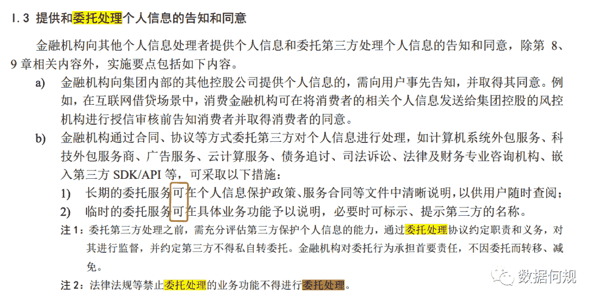

# 定制礼品的告知同意

> 来源：[https://docs.feishu.cn/docx/FQeYdx8AEoSDchxwx4PcBHFEnvf](https://docs.feishu.cn/docx/FQeYdx8AEoSDchxwx4PcBHFEnvf)

**-问：**现在大家向高客提供定制化礼品，例如给客户定制个署了客户名的产品，这种对外给厂商提供客户名单前是还给客户做告知同意？？

**-答1：**这应该是**委托处理**场景，签好DPA，在收集的信息的时候获取客户同意就行吧

**-答2：**要看啥性质的订制，一般标准服务在合同里明确授权就行。如果是非标服务且没有约定，要看是否直接对C端，直面C端的需要补充告知，面向B端的可以通过B端获得补充告知和授权。

**-答3：**我觉得隐私政策覆盖了就好，算委托处理。委托处理告知要求也没有说要细化到受托方是谁吧。

[委托处理的认定](https://cbe8t1r4a5.feishu.cn/wiki/wikcnI9bUNcMQF7zv6VwnXiNX48)

[告知](https://cbe8t1r4a5.feishu.cn/wiki/MBURwAcGAikdAmkoOqJcwnmKnPh)

[合法性基础](https://cbe8t1r4a5.feishu.cn/wiki/wikcnMO3dv4wwxpr7KunwIHHfwd)