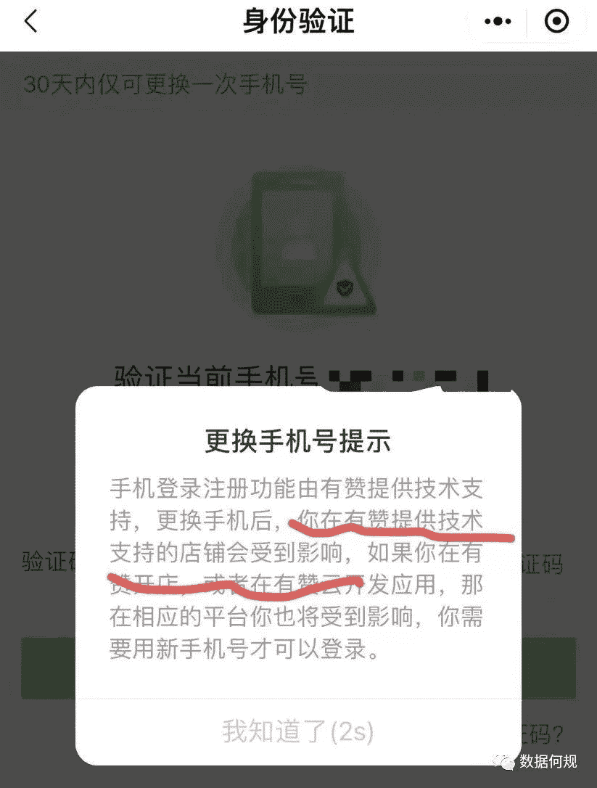

# 有赞与电商商户的关系

> 来源：[https://docs.feishu.cn/docx/C0QTdGuxNoR5y3xcSBBcvoICnNe](https://docs.feishu.cn/docx/C0QTdGuxNoR5y3xcSBBcvoICnNe)

**-问：**有人了解有赞与使用有赞SaaS服务建电商小程序的经营者之间的法律关系不？但这批电商小程序和有赞的账号有绑定嫌疑，截图里的更换手机号提示也挺可疑。AB两个使用有赞saas服务建的电商小程序，在A修改绑定的手机号，结果会同步到B。如果有赞是受托人，这怕是超越处理目的了。

**-答1：****有**赞是个品牌（处理者），并不等于有赞建站小程序（委托处理的角色），有赞旗下还有有赞云，有赞小程序技术搭建，有赞支付。这样可以说服你吗？

**-追问：**我想追问下在建站场景下有赞要求小程序/app用户注册有赞账户，有什么法律上的合理性吗？用户是否可以拒绝小程序/app将个人信息提供给有赞，用于注册有赞账号呢？实际操作体验是，有赞和app/小程序的账号注册是捆绑的，必须同时注册。除捆绑注册外还有一个问题：不仅建站服务委托方A需要把个人信息提供给有赞用于注册，A的个人信息变更还会传导至B，这就完全不在建站服务的委托处理关系内了。

**-答2：**法无禁止即可为。**合同，意思自治，授权。**跟**捆绑注册还有一点**点不太一样，为啥呢，捆绑注册是可以拆分的， 可以只注册一个且不会影响另一个使用，但有赞那套不行，不行的原因是底层技术架构决定的，就是SaaS服务，并不是私有云啊，更不是本地**化部署，账号啊，存储**啊都是在有赞的公有云上，咋切割呢。 一旦切割会面临一个SaaS技术难题，就是我用123245去A的小程序上注册了一个账号，过几天我再用12345去B的小程序上注册一个账号，后台怎么去区分这两个账号呢，可以区分，就会很怪。如果说是独立部署的话好解决，但现在是通用SaaS,就会设计的无比复杂，所以最后干脆，系统判断触发账号合并。

**-答3：**最近我也是遇到了这个问题。一个客户和一家类似有赞的SaaS服务商（创客匠人）合作，服务商给她搭建小程序店铺。我问服务商：用户在A店铺注册的账号，是不是你的平台账号？对方就跟我绕，说进A店铺就在A店铺注册，进B店铺就在B店铺注册。

**-答4：**可以理解为一个saas账号逛遍AB店铺么？

**-答5：**那也得注册，不是默认 A 店通 B 店通 C 店。前面你的疑问：也是做了隔离的，不会发生我在 A 店修改了手机号，就自动更新了 B 店的手机号。

**答：历史问题，很复杂。**

[委托处理](https://cbe8t1r4a5.feishu.cn/wiki/wikcnNszO9ekChKQOUXF76MHUEb)