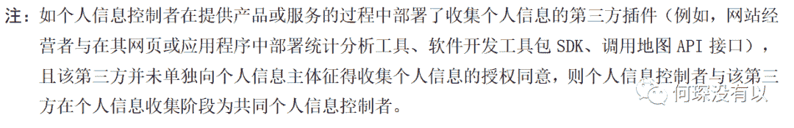

# 共同处理典型案例

> 来源：[https://docs.feishu.cn/docx/YAS0d42BNoflZkxXQEccJgafnmc](https://docs.feishu.cn/docx/YAS0d42BNoflZkxXQEccJgafnmc)

**-问：**大家有没有遇到过比较典型的共同处理的case?

**-答1**：《个人信息安全规范》那个共同控制的例子有些抽象。还有母子公司一起办活动促销，这种应该算吧。

**-答3**：曾经问过某位教授，他认为用户扫码美团下单，美团把用户订单数据下发给商家，是共同处理。但我觉得处理目的仅由商家决定，更像委托处理，相当于商家为了优化自己的点单程序外包了。

**-答4：**[张新宝老师](http://mp.weixin.qq.com/s?__biz=MjM5NTg4NjU2OA==&mid=2247483782&idx=1&sn=6a7aad6cf5be22bc5c30f2e491e2b2f0&chksm=a6f0e50191876c17d7045ed529b857751492ec08577680d1da45785fc8235e111291f4fc5a6f&scene=21#wechat_redirect)在其《个人信息保护法》释义一书中的共同处理和对外提供都引用了🛰️读书案。但这个是主体之间没理清关系，法院一锅端判的。

**-答5：**这个看起来有些像29条工作组有关控制者和处理者概念的指南里订票的例子。虽然所解释的法律概念未尽相同，这个指南还是目前比较详细的相关讨论之一，可能也是其他一些观点的源头。

**-答6：**国内对这块的关系并没有非常详细的判断细则，也不清楚监管有没有细化规则的计划，只能看GDPR指导了。

[共同处理](https://cbe8t1r4a5.feishu.cn/wiki/wikcngAibjKzbFjhGSAUtb0RqWc)