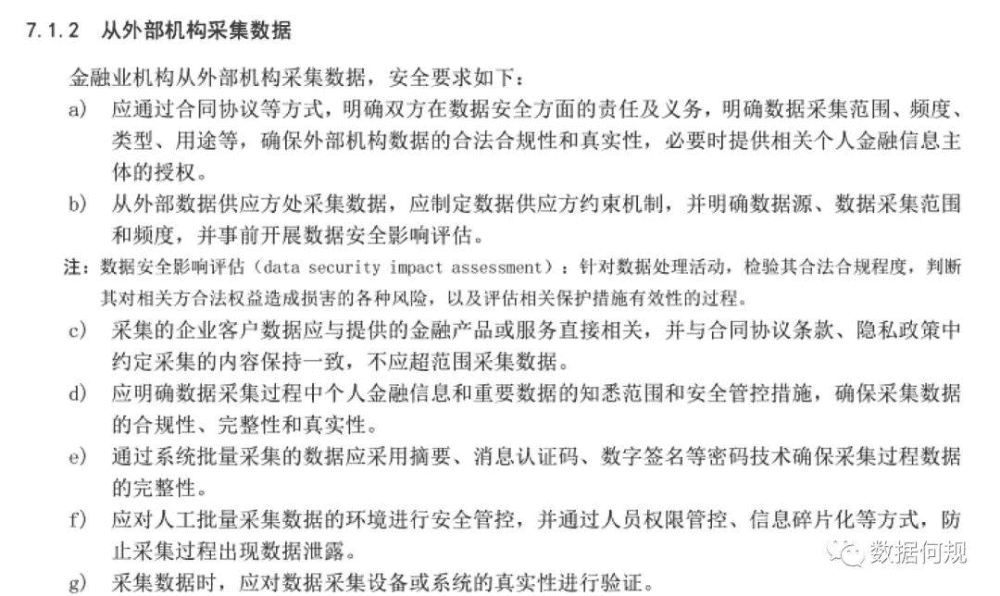

# 数据交易中披露来源是强制的吗

> 来源：[https://docs.feishu.cn/docx/GVX6dUy8doiuqjxo72TcX6zsnec](https://docs.feishu.cn/docx/GVX6dUy8doiuqjxo72TcX6zsnec)

**-问：**想请教一下大家，《数据安全法》第三十三条规定，数据交易中介服务机构应当要求数据供方说明数据来源，但是没有要求对外披露。仅检索到《天津市数据交易管理暂行办法》提出数据供方应对数据需方披露数据来源，其他地方性法规里也没有要求披露数据来源。理解来源的合规性需要评估，但是是否需要向数据需方披露具体的来源？还是仅披露来源合规就行？

**-答1：**《数据安全法》第32条还强调任何组织、个人收集数据，应当采取合法、正当的方式，不得窃取或者以其他非法方式获取数据。

**-答2：**（1）如果是场外交易，本身数据需求方采购数据时，就应该对数据供应方做一个尽调，来确保自己接收的数据是不是有合规瑕疵的，直接采购的数据，除了合同要求承诺外，我们会做一个数据供应商的尽调问卷，请供方写清楚数据产品的生产逻辑和授权情况并提供相应的证据；

（2）如果是场内交易，很多数交所都在做数据产品的合规审查，有的是要第三方中介服务机构背书，有的是数交所内部自己有团队去做合规审查，无论是哪一种，数交所已经通过一定的手段核查过上架的数据产品的来源的合规性，选择场内交易，其实就是选择了数交所来背书，这个情况下，需方只需要了解数交所对数商的筛选机制，就不一定再事事亲力亲为，自己跑去要求供方披露数据来源了

**-答3：**哪个数交所现在是自己在做数商合规审查啊？我看到的好像都是让第三方做的。

**-答4：**广州目前是自己做的，第三方进场通道还未开放。而且还不收费。

**-答5：**当然他们也会寻求一些外部帮助。

[数据资产/交易](https://cbe8t1r4a5.feishu.cn/wiki/wikcnPyaE1oajBNz2NZmDkFmY7f)

[对外提供](https://cbe8t1r4a5.feishu.cn/wiki/wikcnKiT2Zx8SW3B6K4rfGKmXee)