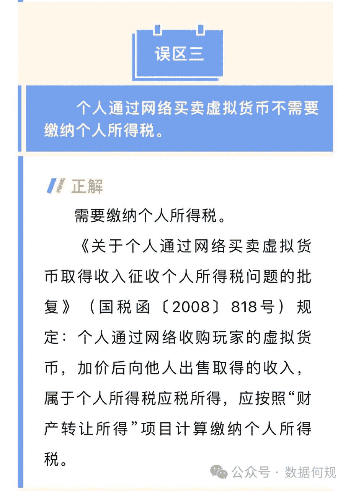
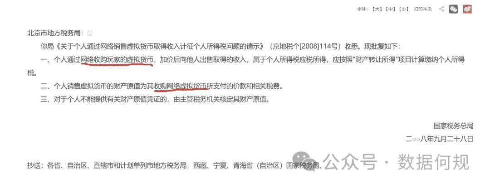

# 虚拟货币交易缴税的的澄清

> 来源：[https://docs.feishu.cn/docx/HbgPd6aqRouxnSx3T2ycS3wcnTd](https://docs.feishu.cn/docx/HbgPd6aqRouxnSx3T2ycS3wcnTd)

**-问：**话如何看待上海税务公众发布的：

**-答1：**相当于认可虚拟货币可以个人用户之间交易啦？

**-答2：**他这个不是针对网络游戏的虚拟货币吗，还是就是BTC这类的？我记得 07 08 那段时间，政策应该是跟网游那块相关的吧。

**-答3：****个人理解还是不能因为一篇公号文章就否定237号文的规定和要义。这篇公号文章引用的依据是税务总局2008年9月的818号文，而237号文则是在2021年9月由人民银行、央办、最高院、最高检、工信部、公安部、市监局、**银保监会和证监会、外汇局联合发布的，其中开宗明义“虚拟货币不具有与法定货币等同的法律地位”、“虚拟货币相关业务活动属于非法金融活动”。“新法优于旧法”，且237号文还是十部委联合专门针对虚拟货币交易的发文，如有冲突的话还是得遵守237号文。

**-答4：**这里只是特化在网游场景，简单理解为玩家间买卖虚拟道具、虚拟货币即可，不能过度解读。说白了，这篇推没有提出新要求新观点。他只是引用了这里的表述而已。08年北京地税的请示，里面用的术语不精准，跟现在不一致也正常。

**-答5：**游戏币本身应该是虚拟商品的一种吧，不同游戏间的游戏币不能直接交易都得通过法定货币作为中间桥梁，和btc那种在国外能具有支付流通性质的不同。

**-答6：**说明一下，游戏行业现在不使用“虚拟货币”“网络游戏虚拟货币”的表述哈，官方表述是“网络游戏币”“游戏币”——《网络游戏管理办法（草案征求意见稿）》虽然没有生效，但对这个术语的使用还是非常严谨的，完全没有“虚拟货币”这个词出现过。again，尊重237号文。游戏行业也如是，这个行业监管严格、还是遵纪守法的企业多哈。现在网络游戏运营企业合法发行的是“游戏币”、不叫做“虚拟货币”，失之毫厘谬以千里，但很多地方监管机构甚至法官都搞混了。

**-答6：**理解。只是之前一向理解对于网络游戏货币的用户间交易也持比较谨慎的态度。主要由于其虚拟属性，也容易引发二级交易、炒作。所以市场上游戏货币、虚拟道具之间的用户间交易，感觉也是极为少见的。

**-追问：**游戏币充值是否适用单用途预付卡规定？或文化部另有规定？或者说，支付准入合规怎么决定？是否需要解决支付牌照？

**-答7：**单用途归商委管，多用途人行管。

**-答8：**网络游戏早年是文化部和出版署在争夺管辖权，大部分规定（包括游戏币）都是文化部出的，等到18年文化部退出竞争后才把监管职能转移给出版署。整体来看跟支付行业关系不大，我理解也不用折腾支付牌照。

1.  **-答9：**一般来说无非几种：
礼物卡机制，在购买游戏虚拟资产的同时指定转让给游戏好友；
官方/第三方交易平台，需要官方本身机制支持游戏资产交易机制，如藏宝阁；
账号整体交易，一般私下买卖账号

一般不涉及支付准入和代币发行，理解为**购买虚拟商品就行，搞双向流通那很麻烦的。游戏币也只是虚拟**商品的一种，只是在游戏内部具备一定的兑换属性，网游新规还限制游戏币不能跨游戏通兑。

**-答10：**拿昨天这个回复炒作的币圈玩家太多了。个别自媒体称：游戏币和虚拟货币法律定性别无二致。简直是对游戏币的污名化。

**

总结**：明确互联网积分管理的“三条底线”。一是禁止挂钩人民币，绝不能和人民币进行双向兑换；二是控制使用范围，互联网积分的使用范围须在平台内部，一些平台上参与交易的不同法人主体之间不能通用，消费者之间不能相互转让；三是限制持有收益，虚拟货币自身不可附加任何利息。网络游戏类虚拟货币，其主要在封闭环境中运行，使用范围及属性与互联网积分类似。是官方说法。

游戏币和比特币那些完全不是一种东西，个别自媒体真的唯恐天下不乱。

[数据资产/交易](https://cbe8t1r4a5.feishu.cn/wiki/wikcnPyaE1oajBNz2NZmDkFmY7f)