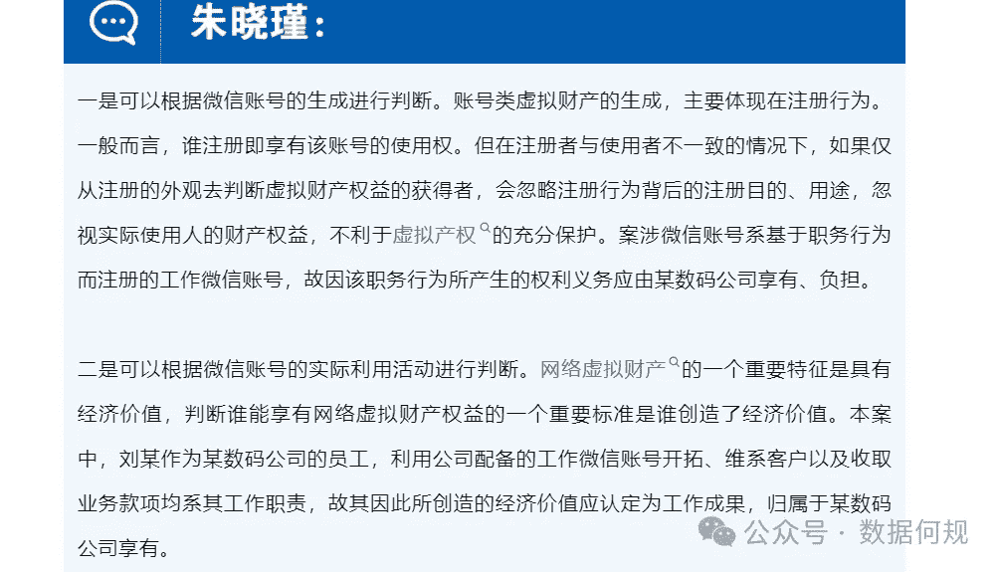

# 工作🛰️的归属

> 来源：[https://docs.feishu.cn/docx/F3J8d9A6yomJqixqQOgcqmQBnof](https://docs.feishu.cn/docx/F3J8d9A6yomJqixqQOgcqmQBnof)

**-问：**大家怎么看这个案子？[员工离职，留下🛰️再走？](https://mp.weixin.qq.com/s?__biz=MzU2NzcwMTIwMA==&mid=2247523262&idx=1&sn=9865ff95c252049566278bc7d5356bbd&scene=21#wechat_redirect)

**-答1：**涉案是个微，看介绍是员工私自变更了认证，昵称。企微没办法变更认证的。很多场景下公司让个人用个微，就拿法律培训行业，很多都还是销售拿着个微来加人 推销的。

**-答2：**那个微凭啥说是公司账号？这个论理逻辑好像不是很清晰。

**-答3：**这个一直有争议的， 特别是网红行业，广互之所以发出来，也就是因为有争议，来亮个相（流量也是政绩）。

通常做法：**1**、公司会用公司申请的手机号注册。2、公司会和认证员工签署一个账号使用协议。此处认证员工和使用员工必须隔离，不是同一人。3、账号密码统一管理。

**总结：事前做好防御。**

[数据资产/交易](https://cbe8t1r4a5.feishu.cn/wiki/wikcnPyaE1oajBNz2NZmDkFmY7f)