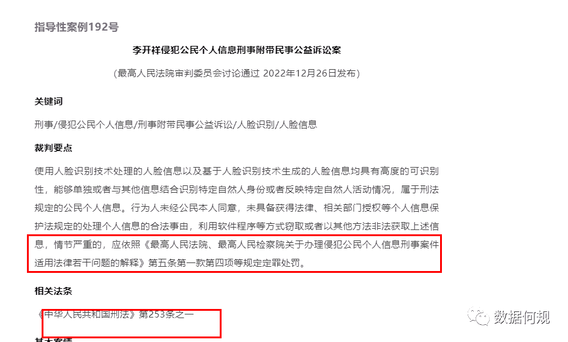
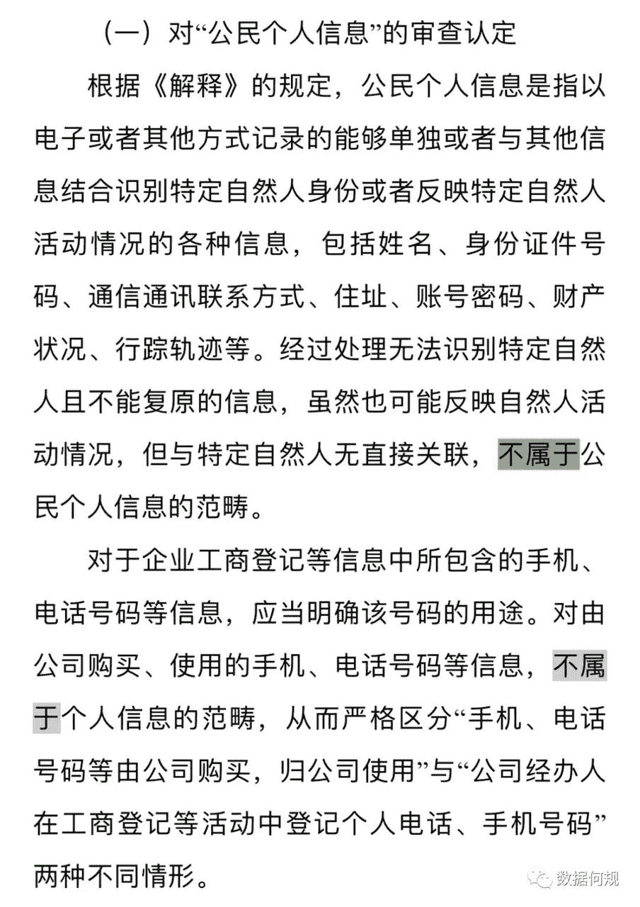
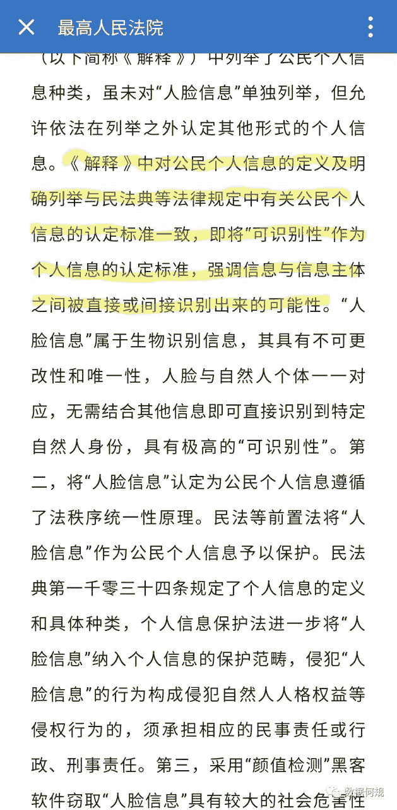

# 刑事案件中个人信息的认定

> 来源：[https://docs.feishu.cn/docx/EFqkddGNlorQ4lxIKS9cQ68XnQb](https://docs.feishu.cn/docx/EFqkddGNlorQ4lxIKS9cQ68XnQb)

**-问：**请教下：最高法近期发布的个人信息保护刑事案件中为啥不提，是个保法 规定的敏感个人信息呀（身份证、人脸是敏感，后面两个我不确定）。为啥没有援引一下个保法？

**-答1：**刑法对个人信息的认定更为严格，不能直接援引民法和个保法的相关定义。

**-答2：**罪刑法定。

**-答3：**说到这个，想起来检察机关办理公民个人信息案件指引中对于一些场景不属于个人信息的情况的列举也特别有趣。

**-答4：**刑民案件的处理思路还是不一样啊。

**-答5：**可能真不一样。指导案例里是只提到了识别标准。这里似乎没有将关联标准纳入范围？

**-答6：**对由公司购买、使用的手机、电话号码等信息，不属于个人信息的范畴 —— 是指的那些完全跟个人主体不相关的吗？手机号也没要求个人实名的类型吗。