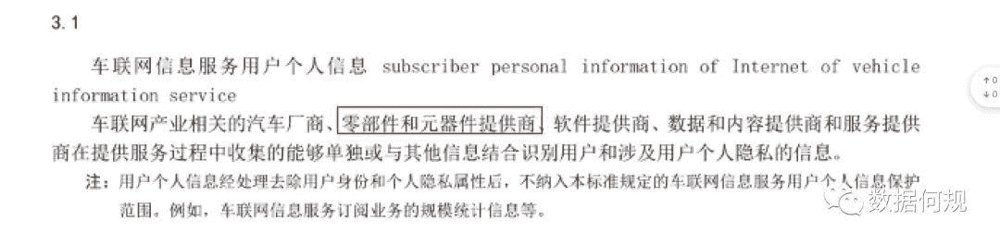

# 为什么车辆零部件是个人信息

> 来源：[https://docs.feishu.cn/docx/EX9rdHcsRoMPypxPp7rcThJrnLf](https://docs.feishu.cn/docx/EX9rdHcsRoMPypxPp7rcThJrnLf)

**-问：**请教下，零部件里怎么也会涉及 个人信息呀。没大明白。比如，一个螺丝钉怎么会跟个人信息相关联？

**-答1：****这个范**围很广哦，**比如电池**，电池可以算是零**部件，电池**都有电池编号啥的。比较重要的T box就可以算是一个元器件。还有e-call系统 等等。一台车的零部件供应商成百上千家。

**-答2：**米其林轮胎有单独App，可以去看看。

**-答3：****PCB上有唯一编码****，卖给**用户了，就是用户个人信息。再比如车架号。螺丝钉应该不至于。

[个人信息定义](https://cbe8t1r4a5.feishu.cn/wiki/wikcnwGGoWGzMNhr26Z4UO55xVF)