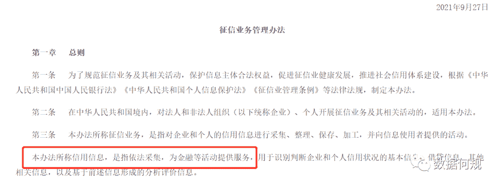

# 信用信息的定义

> 来源：[https://docs.feishu.cn/docx/YZIfdoaKJoLrnRxkgEjcnBPUnXf](https://docs.feishu.cn/docx/YZIfdoaKJoLrnRxkgEjcnBPUnXf)

**-问：**难道非法采集的信息就不属于该办法规制的范畴吗？

**-答1：**因为**正当的征信业务**范围是建立在信用信息概念上的，违法采集个人信息用于信用评估的肯定不是信息用信息啦。

**-答2：**可以看看这条。

> 采集个人信用信息，应当采取合法、正当的方式，遵循最小、必要的原则，不得过度采集。

> 《征信业务管理办法》第七条

**总结：合法采集是基础。**

[个人信息定义](https://cbe8t1r4a5.feishu.cn/wiki/wikcnwGGoWGzMNhr26Z4UO55xVF)