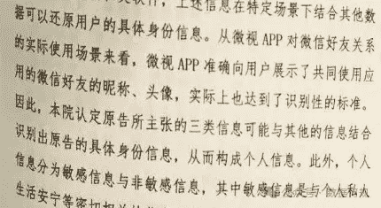

# 用户昵称、头像是个人信息吗

> 来源：[https://docs.feishu.cn/docx/J4iYd5y01owWNuxOKMncahIln4b](https://docs.feishu.cn/docx/J4iYd5y01owWNuxOKMncahIln4b)

**-问：**📕/🧣的用户昵称和头像算不算个人信息啦？

**-答1：** HK的都这么搞。

**-答2：**唯品会案，头像应该是判决了属于，昵称有讨论的空间。其他应该还有几个案子。周彦聪诉广州唯品会电子商务有限公司个人信息保护纠纷案。

**-答3：**把昵称认定为个人信息的案子，四川这边就有个，好像是“扫码点餐”。

**-答4：**肯定算，头像可能是照片，昵称可能是真实姓名。

**-答5：**回看了一下都认定为是。当时的讨论集中在自动生成的默认昵称（xx会员）的性质上，也认定属于。

**-答6：**你去看📕和🧣的双清单啊，明确列了。人家监管费劲巴拉的搞双清单，结果你们不看。

**-答7：**你看下授权。头像昵称你要点个同意的。

**-答8：**微视案。类似案件一堆，尤其是个人诉互联网公司的。

**总结：算，没有讨论空间。**

[个人信息定义](https://cbe8t1r4a5.feishu.cn/wiki/wikcnwGGoWGzMNhr26Z4UO55xVF)