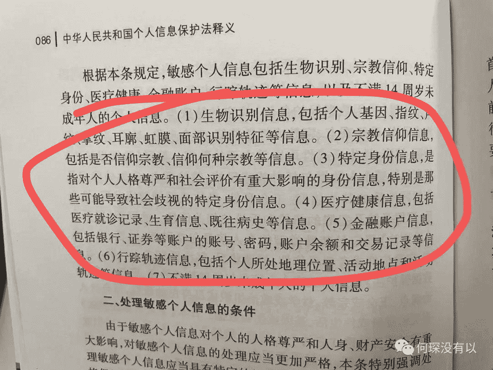
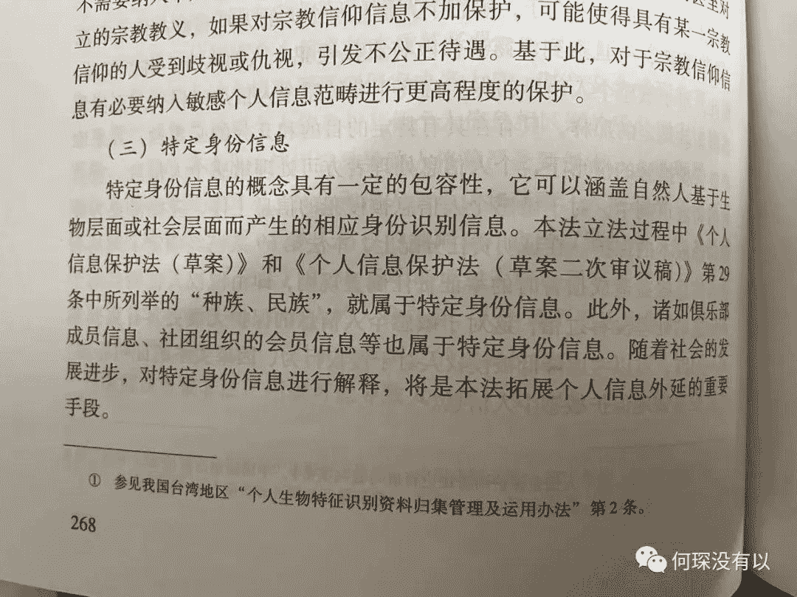

# 敏感个人信息的特定身份的范围

> 来源：[https://docs.feishu.cn/docx/LucFdHQUCoym5FxoINlcsbijnGd](https://docs.feishu.cn/docx/LucFdHQUCoym5FxoINlcsbijnGd)

**-问**：个人敏感信息中的**特定身份**的范围具体指什么？我理解有宗教信仰、党派这种。

**-答1：**法院院长，军长等。具体可参考下文：

（一）根据中组部、公安部等5部委印发的《关于加强国家工作人员因私出国（境）管理的暂行规定》（公通字［2003］147号）及教卫党委有关通知精神，结合医学院及附属单位实际，特定身份报备人员范围应为如下：

1、在职和退（离）休的市管干部；

2、所有正处级以上干部；

3、各单位班子成员、院长助理；

4、各单位以下重要岗位人员

（1）院长办公室、党委办公室负责人；

（2）组织、纪监审、人事、财务、资产、科研部门负责人；

（3）产业部门负责人；

5、涉密人员（涉密科研项目负责人、机要员等）；

6、其他（由各单位根据实际情况自行确定）。

**-答2：**看看法工委和最高院的态度吧。

法工委的话不多，但是很重要：“对个人人格尊严和社会评价有重大影响的身份信息”。比如说LGBT群体？

最高院的书介绍了条文变迁，草案中的用词都是“种族、民族”，这些也肯定是。

**-答3：**我感觉还有一种情况可能就是涉刑、刑事处罚的身份或身份历史，包括罪犯身份、受害人身份。

[敏感个人信息定义](https://cbe8t1r4a5.feishu.cn/wiki/wikcn6iCB7XJoSBE53HR3RR0sle)

[个人信息定义](https://cbe8t1r4a5.feishu.cn/wiki/wikcnwGGoWGzMNhr26Z4UO55xVF)