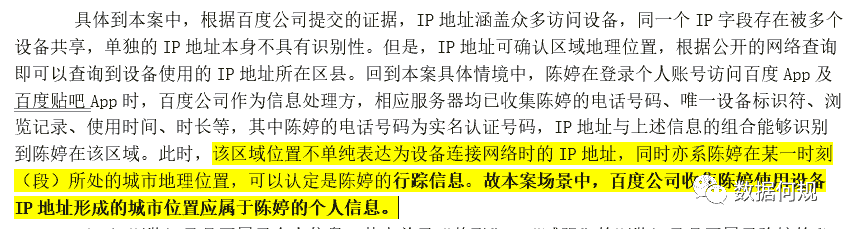

# 地理位置和行踪轨迹的关系

> 来源：[https://docs.feishu.cn/docx/ILfSd9CRpo3iSvxrDvxcTD16ncd](https://docs.feishu.cn/docx/ILfSd9CRpo3iSvxrDvxcTD16ncd)

**-问：**想请教一下大家，地理位置和行踪轨迹，二者之间的关系和界定？行踪轨迹是由一序列的地理位置组成的，更偏向于线性、动态的轨迹，而地理位置则是一个静态的点或者区域？今天检索案例，见：（2021）鄂11 民终3136 号的时候，发现一个案件，法院认为基于IP地址形成地理位置（精度为市），可以认定为行踪信息。（一审二审认定一致）从动态的视角考虑？虽然现在只是一个点，一个区域，未来可能会形成轨迹？

**-答1：**我理解行踪轨迹范围更大。比如信通院这次对敏感个人信息做pia，有一列就是行踪轨迹。看模板，地理位置应该这样往上面填。至于为什么地理位置也被法院认定行踪信息。因为能反映出省市，对于部分人来说已经属于非常隐私外泄了。比如到北京约小三旅游，和老婆说海南团建。

**-答2：**35273里面，行踪轨迹和定位是一类数据，实践中，有时候很难区分，案子里的意思是，空间加时间了，不是一个简单的定位。

**-答3：**按这个逻辑，回帖公开的IP地理位置都是敏感个人信息？

**-答4：**百度虽然收集了原告地理位置，但这就是可能违反最小必要性，还不至于当被告，所以还是得回到案件本身。

**-答5：**IP地址和IP属地不是一个东西。IP地址可以精确门牌号码的。

**-答6：**判决原文的表述是：基于IP地址形成的城市位置，那这样，不就和目前的IP属地类似了吗，也是IP地址中分析出来的。

**-答7：**简言之，我持续收集(x,y,z,t)这个数组，我实际上就是在收集行踪轨迹。

**-答8：**判决的原文是说IP地址结合原告的手机号码、唯一识别标识码，可以精准定位到原告个人，因此是个人信息；又结合登录使用时长。登录次数，是某一时刻的地理位置，可以认定为行踪轨迹。

**-答9：**地理位置就是一个相对比较简单的概念，比如 （经1 . 纬1）行踪轨迹需要结合其他因素，一般人的理解至少包括两个地理位置 （经1 . 纬1） （经2 . 纬2）。甚至可能包括其他内容，如时间（时间1） （经1 . 纬1） 、 （时间2） （经2 . 纬2）。判决的关键并不是你所指的 基于IP地址形成地理位置（精度为市），可以认定为行踪信息。这里明明关键在于 时间+位置 ，而且是和其他信息组合，然后实现了 “识别” 这个特征，所以被认定为个人信息。

**-追问：**我好奇一个问题啊，国内IP地址不是动态的嘛？这个咋精准定位哪？

**-答10：**先说精准定位这个，就跟孙律师及我们上面提到的，并不是仅仅依靠IP地址对你进行精准定位的，有很多不同的信息可以相结合，最终完成识别，当然，最终并不一定非常精准。其次，讲一下IP地址这个东西，我也不是特别懂这个，用通俗一点的话来说，比如你从电信移动联通之类的接个宽带，那么你应当比较清楚，起码你通过接的宽带向互联网发送数据的时候，电信移动联通如果想知道你的地址是比较简单明了清晰的，毕竟你发的数据咋都会过他们一手，如果有需要，查你相当简单。有几个概念是有必要了解的：（1）动态IP；（2）静态IP；（3）DHCP协议；（4）NAT（Network Address Translator）；（5）全局IP地址。你理解的IP地址动态这个，实际上并没有那么“动态”。动态是相对而言的。当然这种涉及的基本远超一般法律人要求掌握的内容了，可能只有确实是做这一块（数据合规），在某些特定实务的时候，才需要作为常识去理解。之前有段时间国家对挖矿的行为进行查处，就有一部分是通过直接运营商查特定数据包和分析数据包特征的方式做的。技术上，基本不会有太复杂的难度。只能说，如果确实是用国内的 实名的手机卡、宽带，用相对比较没怎么加密的软件，发送没怎么加密的信息的话，需要符合国家的法律法规的规定以及相关部门、政策的要求。当然，见得比较多的虚假IP（比如有些账号运营就要用一些人在国内但是假装人在xx刚下飞机）的工具，也有，但是正如前面几位老师说的，这个并不重要。另外也如孙律师说的，定位你，不一定需要位置权限（IP就更不需要了）。

总结：做数据合规还是需要懂基本技术概念。

[个人信息定义](https://cbe8t1r4a5.feishu.cn/wiki/wikcnwGGoWGzMNhr26Z4UO55xVF)

[敏感个人信息定义](https://cbe8t1r4a5.feishu.cn/wiki/wikcn6iCB7XJoSBE53HR3RR0sle)

[技术概念科普](https://cbe8t1r4a5.feishu.cn/wiki/GfWtwCXWbiBzgQk1sxUcfFgXnSP)