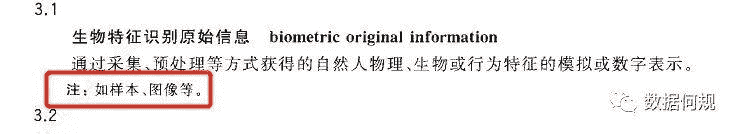
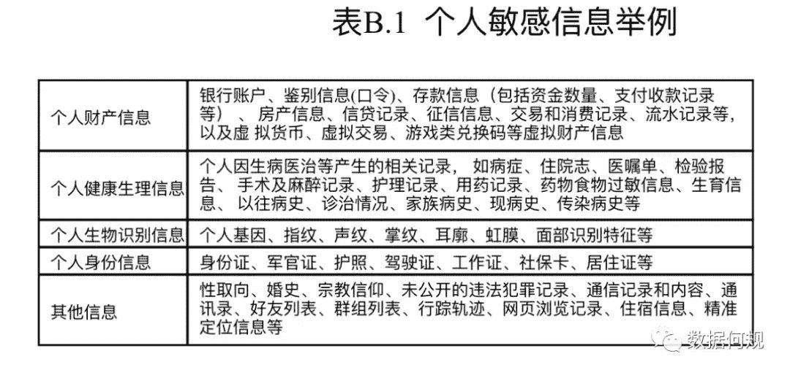
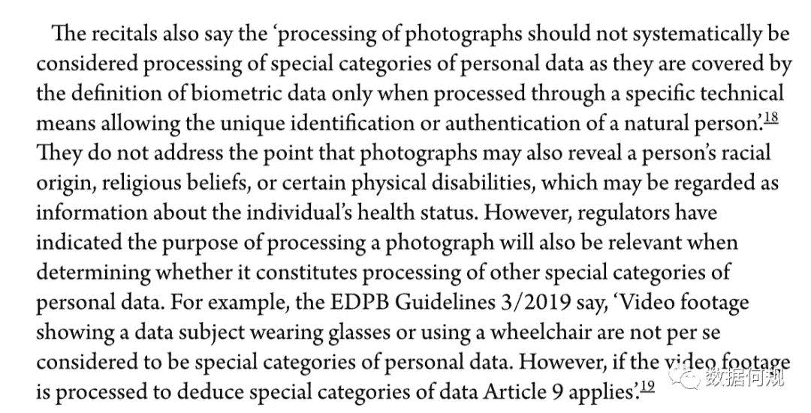
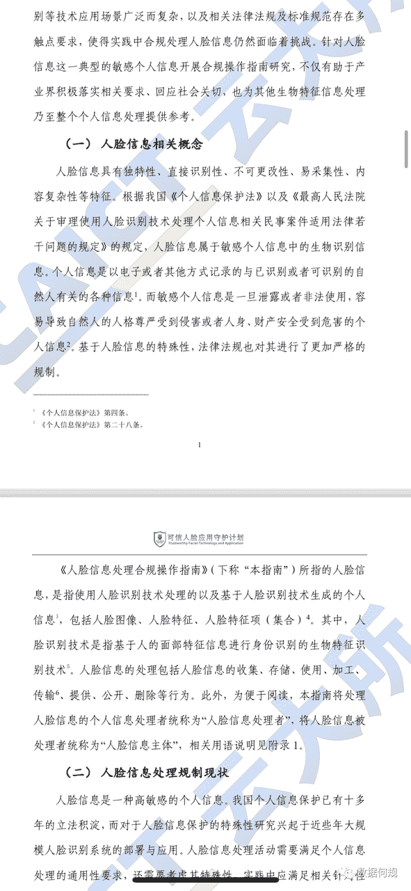
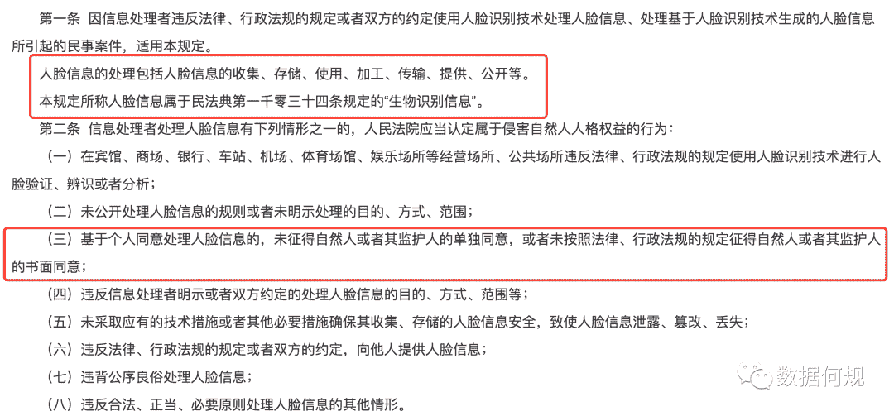
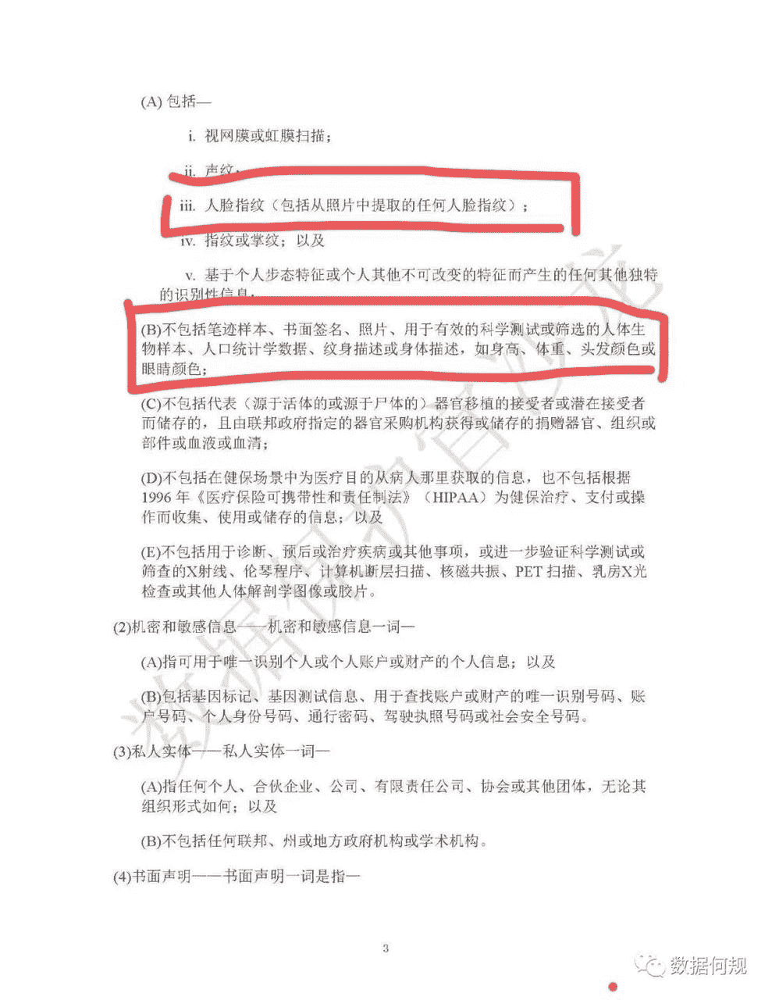

# 照片是敏感个人信息吗

> 来源：[https://docs.feishu.cn/docx/B6qGdHbJtoQsDQxjlNTc9Paqnnc](https://docs.feishu.cn/docx/B6qGdHbJtoQsDQxjlNTc9Paqnnc)

**-问：**我记得之前群里讨论过照片需要经过处理才属于生物特征识别信息，国标好像把图像直接定义为原始信息了，是我理解的有偏差吗？

**-答1：**照片照片原始信息不一定全是生物特征识别信息 ，但属于敏感个人信息  这个国标的图像表述应该和普通的照片应该不是同一个概念吧。问问标准起草的看。使用 SKimage 的图像预处理，看概念 图像的范围在计算机领域感觉很广。

**-答2：**使**用场景导**向，收集不识别，构不构人脸识别 。照片按照照片本身的属性定义。收集目的是识别就根据人脸信息处理来定义。

-答3：照片还不敏感嘛，能从里边提取很多信息啊，宗教信仰肤色之类的，结合一下个保法的概念理解，应该算的。

**-答4：**抛个暴论，35273没有，不认定了，不然和业务说要单独同意可能被骂死。

**-答5：**这是cipp教材里面一段话，序言是给了否定解释的，但我上次听海外iapp一个老师讲 他认为照片属于生物识别信息。

**-答6：**这里面也是把人脸图像归类于人脸信息，进而归类于敏感个人信息。做严格解释，图像应该包括照片，照片本身也可用于人脸核身。

**-答7：****我们用到**人脸的功能都做了单独同意和目的告知，自己瞎选的照片也算。-答8：人脸识别司法解释也是相同的观点。

**-答9：**美国生物识别信息隐私法，对于面部识别信息的wording 用的是 face print。美国的这个法案可以看出单纯的照片不认为属于生物识别信息 只有提取的人脸指纹才算。

**-答10：**单纯的照片本质上只是非结构化数据吧。

**-答11：**但仍然属于敏感信息吧，可以用于唯一识别个人？上面图片里定义了敏感信息 所以展开了一下。

[个人信息定义](https://cbe8t1r4a5.feishu.cn/wiki/wikcnwGGoWGzMNhr26Z4UO55xVF)

[敏感个人信息定义](https://cbe8t1r4a5.feishu.cn/wiki/wikcn6iCB7XJoSBE53HR3RR0sle)