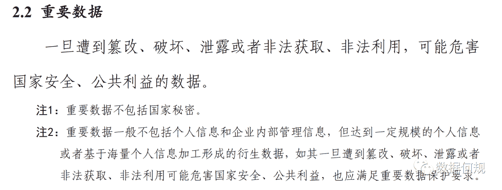
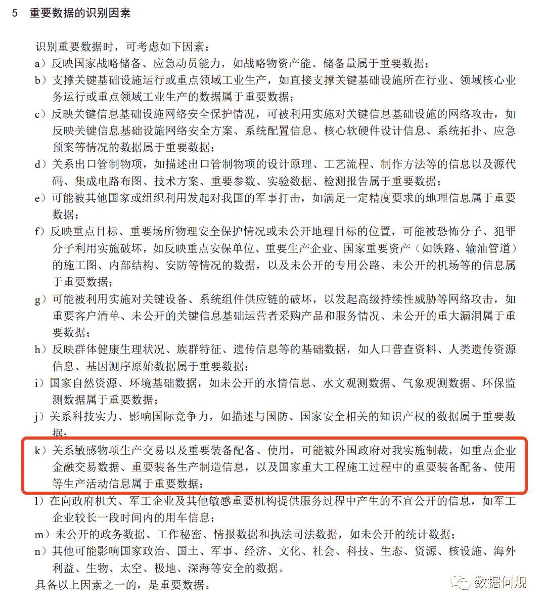

# 财务数据是重要数据吗

> 来源：[https://docs.feishu.cn/docx/FLdydrRtRobEcKx3wDucP4O4nxg](https://docs.feishu.cn/docx/FLdydrRtRobEcKx3wDucP4O4nxg)

**-问：**跨国公司的中国实体的财务数据会被视为重要数据么？

**-答1：**看定义，等目录。

**-答2：**根据《网络数据分类分级指引》对重要数据的定义，其大概率不是重要数据。

《重要数据识别规则（征求意见稿）》亦有相关内容可供参考。

总结：在行业重要数据目录出台前自认有重要数据，是不明智的。

[重要数据定义](https://cbe8t1r4a5.feishu.cn/wiki/wikcny4mT46JDD73jBFYLUpcrMb)