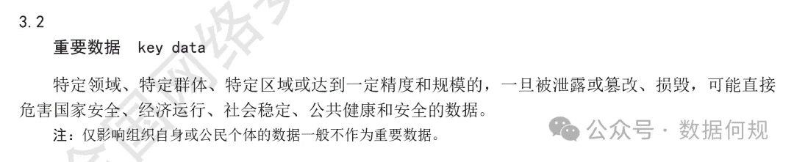

# 重要数据翻译

> 来源：[https://docs.feishu.cn/docx/DoX3dtivMosDkIxJ8KVcC2WbnTg](https://docs.feishu.cn/docx/DoX3dtivMosDkIxJ8KVcC2WbnTg)

**-问：**重要数据的英文，是important data, critical data还是key data呢？好像每个国标都不一样。

**-答1：**刚发的分级分类国标是Key，已经生效了，不是征求意见稿。

**-答2：**可以用important data，我觉得critical有点太重要了哈哈。

**-答3：**翻**译还是要看国外读者的接受程度，像国标里把“数据处理者”翻译成“data processor”就没法直接用啊。我们大概统计过，国**际所还是用important data的最多。Critical一般还是对应着关键，毕竟有CIIO这个词在。key做形容词的英文解释是most important; essential，比important程度要深一些。不过我觉得这俩哪个都可以。

总结：key和important都可。

[重要数据定义](https://cbe8t1r4a5.feishu.cn/wiki/wikcny4mT46JDD73jBFYLUpcrMb)