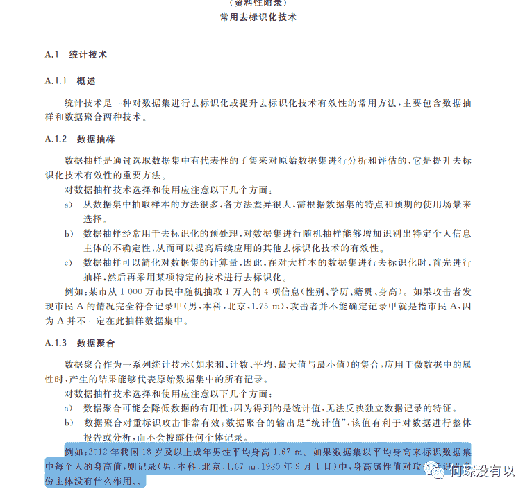
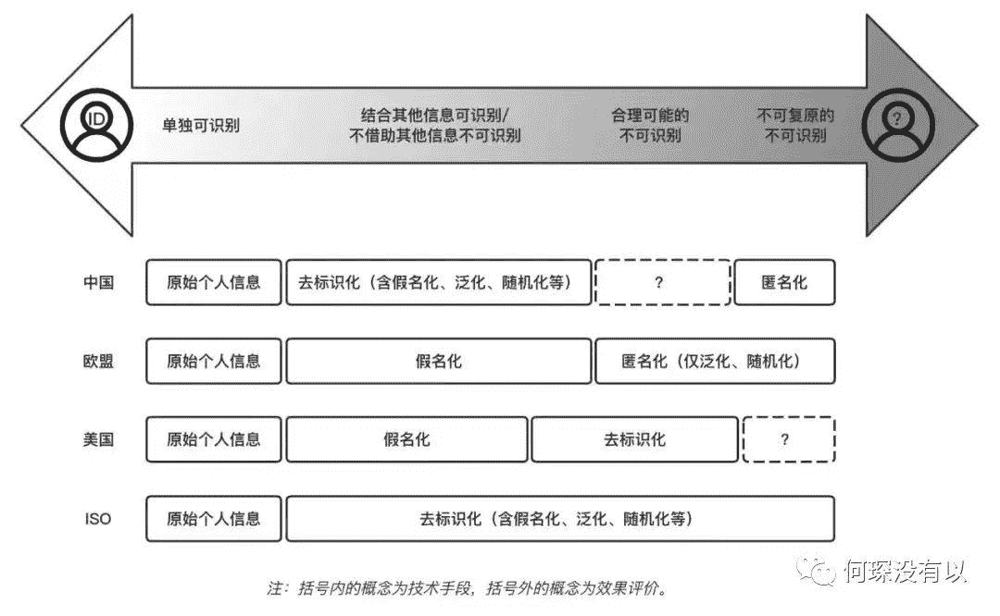

# 去标识的方法

> 来源：[https://docs.feishu.cn/docx/DieRdLnDHopjhnxRJOpcYCIHnOb](https://docs.feishu.cn/docx/DieRdLnDHopjhnxRJOpcYCIHnOb)

**-问**：去标识化国标这段话的意思是：平均值这种统计，如果对外披露，也只能算去标识化吗？

**-答1：**这种都不算个人信息的吧，因为是**匿名化手段**，所以当然地是去标识手段？

**-答2：****感觉去标识化和**匿名化手段只是对个人信息处理的程度不同。

**-答3：**可以参考这篇文章，这个杨律师这个系列都很棒。数据脱敏：不同法域下匿名化、去标识化、假名化的含义一致吗

**-答4：**史律师的这篇学习笔记也可参考：逃离“告知-同意”：《个人信息去标识化指南》笔记。

[去标识化](https://cbe8t1r4a5.feishu.cn/wiki/wikcnBAu86hhXoSNR49Ne8sDRAc)

[匿名化](https://cbe8t1r4a5.feishu.cn/wiki/wikcn8Uugy358llBp1mB46bCJ8b)

[合法性基础](https://cbe8t1r4a5.feishu.cn/wiki/wikcnMO3dv4wwxpr7KunwIHHfwd)