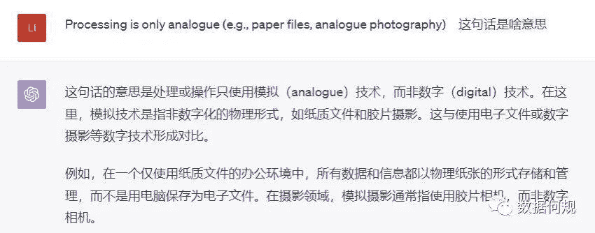

# Analogue的理解

> 来源：[https://docs.feishu.cn/docx/NDPmdt1BiogPg8xg7Iqc6wgSnXc](https://docs.feishu.cn/docx/NDPmdt1BiogPg8xg7Iqc6wgSnXc)

**-问：**Processing is only analogue (e.g., paper files, analogue photography)　有大哥知道这句话是啥意思么

**-答1：**微问了一下Chat gpt

**-答2：**赞同“**模拟**”的解释。可能和第2条第1款有关，用以排除模拟/传统/纯粹手动的处理活动，主要包括手写信笺、缺乏索引目录的文档等。近年来也有FG Munich 15K 194/20等案例。

[技术概念科普](https://cbe8t1r4a5.feishu.cn/wiki/GfWtwCXWbiBzgQk1sxUcfFgXnSP)