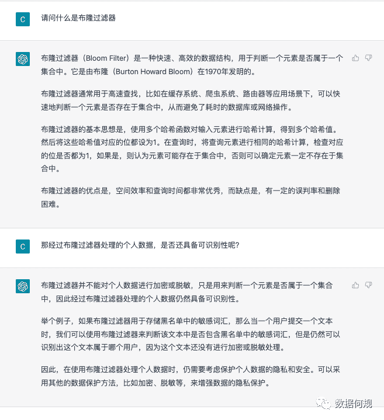

# 布隆过滤器是什么

> 来源：[https://docs.feishu.cn/docx/HB8rdP8IpoKp97xkaSLc9Q9dnmd](https://docs.feishu.cn/docx/HB8rdP8IpoKp97xkaSLc9Q9dnmd)

**-问：**能否简单介绍下布隆过滤器的原理和作用？我理解这是一种加密方式，不影响“对外提供还是个人信息”这个本质。不知道我是不是理解有误

**-答1：**1970 年的时候，有一个叫做布隆的前辈对于判断海量元素中元素是否存在的问题进行了研究，也就是到底需要多大的位图容量和多少个哈希函数，它发表了一篇论文，提出的这个容器就叫做布隆过滤器。

[顺便学习了一下，好像](https://mp.weixin.qq.com/s?__biz=MzUzMTA2NTU2Ng==&mid=2247562812&idx=3&sn=a4ecffce1cbfcf9de60c59bb1ec5b625&scene=21#wechat_redirect)就是个技术领域的解决方案：通俗易懂讲布隆过滤器。

**-答2：**不一定，布隆过滤器对个人信息的识别性核心在于错误率的设置。通俗的话来说，布隆过滤器可以告诉某个东西一定不存在或可能存在。举个例子，在两个系统间传输IMEI，中间架个布隆，如果返回值是0，说明对方系统里没有这个IMEI，如果返回值是1，说明对方系统里可能有同样的IMEI，但也可能是相似但不相同的IMEI。对于是不是个保法的“提供”，还是要回归场景里两家公司的法律关系，21条委托还是23条。上面例子里，如果是查询校验，那就不是个保法下的“提供”。布隆确实是加密、避免一对一对碰的一种手段，但23条还是看场景。仅供参考。

**-答3：**可以解决隔壁是否有人的问题，但解决不了隔壁是不是老王的问题。

**-答4：**Chat GPT的回答。

总结：经过布隆过滤器处理的个人信息，仍是个人信息。

[技术概念科普](https://cbe8t1r4a5.feishu.cn/wiki/GfWtwCXWbiBzgQk1sxUcfFgXnSP)