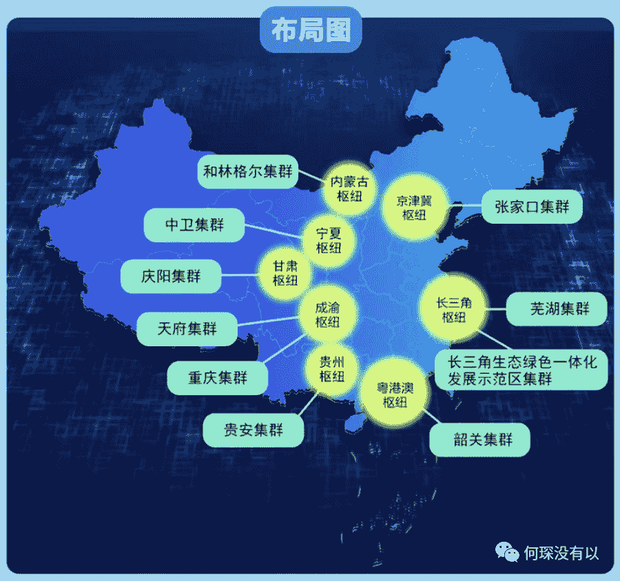

# 东数西算

> 来源：[https://docs.feishu.cn/docx/MwZEdPp8tolRVlxxVkBcqIxTn4U](https://docs.feishu.cn/docx/MwZEdPp8tolRVlxxVkBcqIxTn4U)

**-问：**有朋友了解东数西算工程吗？算力中心是为公共数据服务，还是对外招租，商业实体去租用哦？

**-答1：**可以参考这篇：万国数据 (09698.HK)“东数西算”正式启动。

我知道**万国数据**去宁夏拿地，建自己的数据中心。

**-追问：**还是不太懂商业世界是怎么玩的……现在枢纽和集群明确好了，那各种基础设施的厂商、服务商入场了吗（都需要那些类型的服务商/厂商呢）？

**-答2：**类似于万国数据这样的公司就是服务商。枢纽和集群是地方政府有便宜的电力资源和土地资源，优惠招商政策。

**-答3：**万国主要是做**IDC**的吧，整条产业链很长

**-答4：**大概明白了，国家划了几个区域专门打算建造算力中心——数据中心运营商去买地、建算力中心（数据中心2.0）+一些能源企业的支持+建造企业+网络服务（我看华为也发解读了）——算力中心最后对外招租（服务枢纽对应的集群点）——集群点内的企业把自己的数据托管到这些算力中心去。

**-追问：**像这些IDC运营商，他们会涉及到什么数据合规的业务吗？比如他们帮客户存储数据的时候，是能直接帮客户分类分级吗？还是只是给客户的数据提供一个存储的“场所”。

**-答5：**最后一点可能理解不一样，算力的调度需要考虑最终数据使用的性质（例如冷热数据）和网络架构规划（考虑时延之类的），一般是服**务商提供多个节**点满足用户的不同需求，没法说只局限在一个物理区域。IDC更多还是传统的牌照基建风火水电节能和网络安全。算是物理层、逻辑层的东西多一些，和现在大家讨论用户界面的“数据合规”可能还没太结合。但如果是数据泄露或者危机演练也会考虑IDC的情况。

**-答6：**是，他们应该更注重的是**数据安全和网络安全**。

[技术概念科普](https://cbe8t1r4a5.feishu.cn/wiki/GfWtwCXWbiBzgQk1sxUcfFgXnSP)