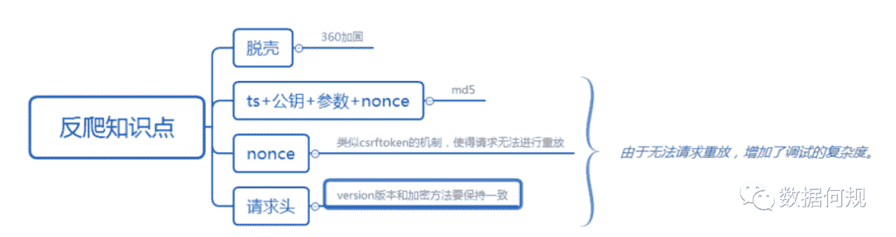

# 逆向爬虫的风险

> 来源：[https://docs.feishu.cn/docx/TIkgdtlmzow5ZdxyslPcWLBrnVb](https://docs.feishu.cn/docx/TIkgdtlmzow5ZdxyslPcWLBrnVb)

**-问：**通过app逆向的方式爬虫合规吗？是否属于规避网站、App设置的反爬措施？

**-答1：**这个要看他们到底是怎么做的，但我觉大概率是属于规避了……你可以问问他们具体是怎么逆向爬取的，如果针对人家这些反爬措施做了对应的的措施，那八九不离十了。爬数据这个问题，就怕技术人员也不会和你说实话，但有时候我也很纠结，我们到底是想清楚地知道技术的所有的细节，然后陷入两难境地，还是维持着他们告诉我们的“体面”，不要深究了。

**-答2：**可参考这篇，[爬虫相关法律风险及案例检索报告](https://mp.weixin.qq.com/s?__biz=MzA5NjgwOTQyMA==&mid=2649320342&idx=1&sn=f4695533bd1b5cdd75972f1ba9440bbd&scene=21#wechat_redirect)。

**-追问：**爬虫这个问题，据我了解到，规避反爬措施，即使爬公开的数据也有可能构成非法获取信息系统数据罪，而且这还是主流的司法裁判观点。我在想现阶段基本都有反爬措施情况下，这么高的风险，为什么都在做爬虫，而且有很多公司也在非法爬。

**-答3：**成本低，收益高。（若不被发现

[技术风险](https://cbe8t1r4a5.feishu.cn/wiki/MYjVw1V1NiYcHOk1OxKchGuUnBb)